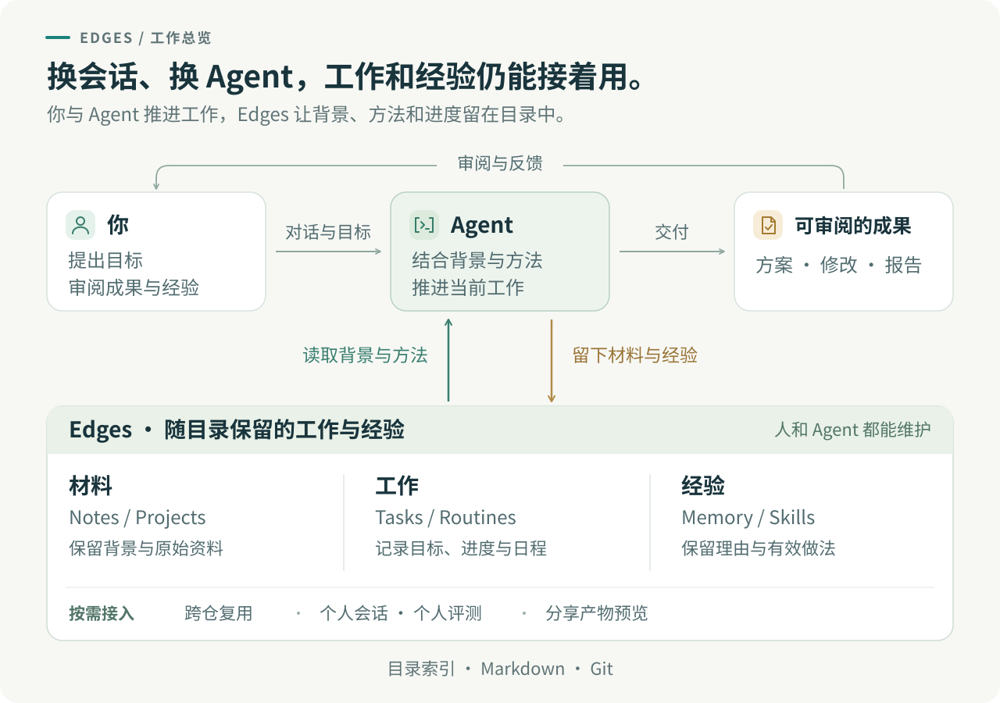
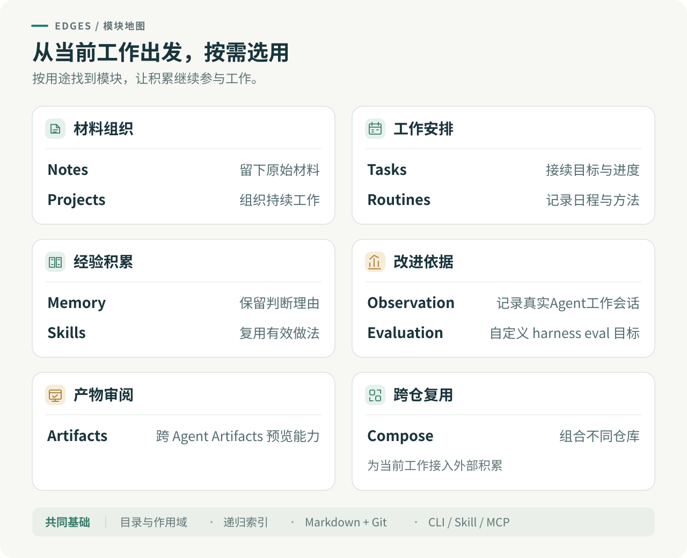
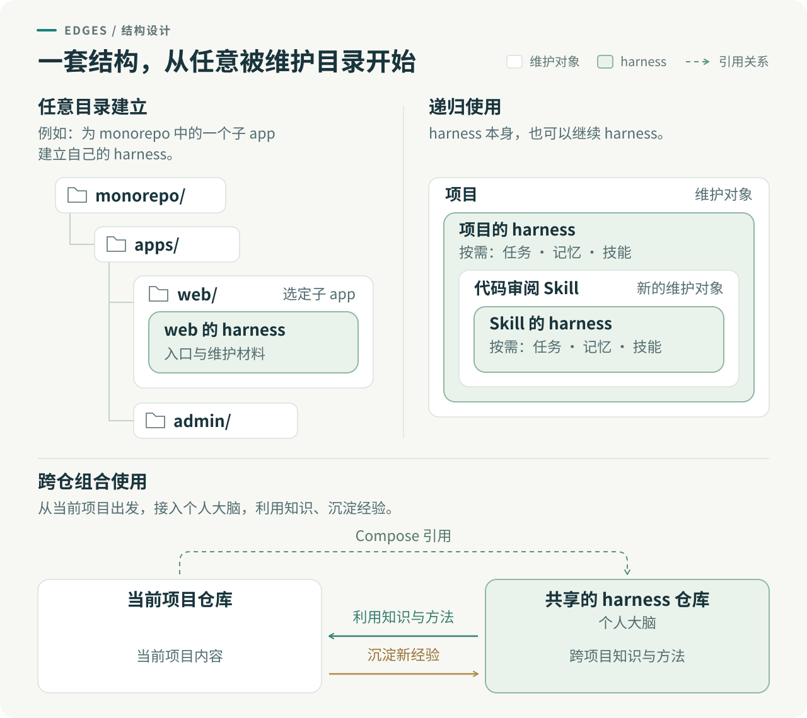
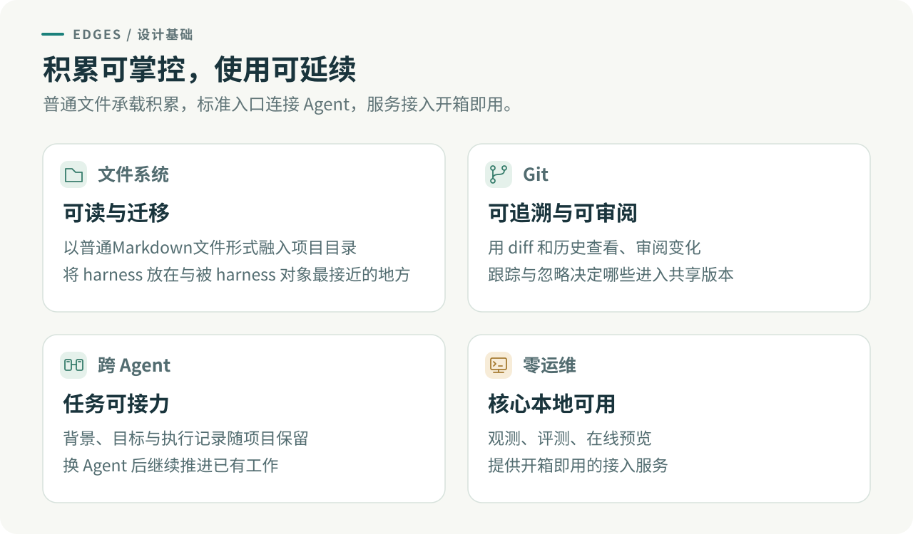

# Edges

[](https://www.npmjs.com/package/@viruspc/edges) [](https://coderabbit.ai)

**harness 任何目录。你的大脑，也是一个目录。**

*Harness any directory. Your brain is one too.*

> 解决 Monorepo 等多业务模块协作场景下，换人或换 Agent 后项目知识丢失的问题。以目录作用域构建递归 Harness，通过 AGENTS.md 和 .edges/ 分层组织记忆、技能与任务，实现渐进式披露；支持以 Harness 自身为对象进行递归维护和持续演进。同时支持以人为 Harness 对象构建 Personal Harness（个人大脑），基于个人真实数据与需求开展 Personal Eval。受控合成实验中，相比平铺记忆，总 Token 消耗降低 35.75%，Agent 用时缩短 15.87%。


[开始使用](#怎么开始) · [实验结果](#实验结果) · [个人大脑案例](#案例把-edges-用于个人大脑) · [深入了解](#深入了解) · [Edges 小助手](https://edges-rag.viruspc.tech/)

## 这是什么，能帮我做什么？

和 Agent 一起工作时，想做的改进、方案的取舍、做到一半的任务、下次可以复用的方法，常常留在聊天里。时间一久容易忘记，换个会话换个人又要重新解释。

**先确定维护对象，再组织上下文。** 你要持续维护的可能是整个项目、某个模块，也可能是一套反复使用的方法。Edges 把相关的经验、技能与维护任务组织到对应目录的 `.edges/` 中，由 `AGENTS.md` 引出，形成**嵌入项目骨架、以文件目录为作用域的 harness**，供不同会话、不同 Agent 接续使用。

**目录决定作用域，Git 管理版本。** 同一仓库中的项目根、monorepo 子 app、模块或 Skill 目录，都可以按需拥有自己的 harness，随各自的维护需要积累材料。



## 为什么值得用？

Edges 识别出 Agent 协作中的关键工作，并为各模块打磨专门的组织方式与使用流程：Tasks 区分任务目标与执行尝试，Memory 按适用范围检索，Skills 保留可复用的步骤与判断。你可以按需组合这些模块，沿用已有的设计，再结合自己的工作持续改进。



共同约定留在项目根，模块的兼容性取舍留在模块旁。即使共用工具与方法，各处的局部经验仍保留自己的归属；需要跨项目复用个人或团队积累时，再通过 Compose 接入共享 harness。

维护对象也可以是方法本身。执行调研时，沿用调研 Skill 的步骤，并遵守当前项目约定；改进这套调研方法时，再进入 Skill 自己的纠正、任务和设计材料。**对象变了，需要组织和读取的上下文也随之改变。**



**想做的事有处安放，做到一半的工作能够接续。** 想到一个改进，可以先留下想做什么和缘由；有时间再沿着已有背景继续推进。普通文件与 Git 让积累可读、可迁移、可审阅，任务背景、目标与执行记录也能供后续会话和其他 Agent 接续。



**Harness 是否真正有用，可以观察，也可以检验。** 围绕被 harness 的目录及其目标，收集各 Agent 下的真实会话，从实际工作中发现问题；用相关材料、任务与判断标准开展对照评测，比较结果质量、约束遵守与成本，让记忆、技能和使用方式的取舍有依据。

## 实验结果

**在受控合成 v1 测试中，两组正例记忆召回均为 100%，分层组织比根目录平铺少用 35.75% 的总 token，平均 Agent 用时缩短 15.87%。** 这是在相同记忆正文下，对分层目录与发现索引的实际检验。

三批测试共 **99 道题、891 次执行，全部完成且零运行失败**。下表分别报告分层记忆（scoped）与根目录平铺（root）的结果，降幅均以 root 为基准；重复执行不增加独立题目数。

| 测试集与完整报告 | 测试题 / 执行次数 | 记忆 recall@5：分层 / 平铺 | 观察到的效率收益 |
| --- | ---: | ---: | --- |
| [受控合成 v1](packages/evaluation/experiments/harness_memory_ablation/harbor/synthetic/RESULTS.md) | 32 / 288 | **100% / 100%** | 总 token **−35.75%**；Agent 用时 **−15.87%** |
| [自然工作请求合成 v2](packages/evaluation/experiments/harness_memory_ablation/harbor/synthetic/v2/TEST_RESULTS.md) | 36 / 324 | 97.78% / 100% | 未缓存输入 token **−22.76%**；Agent 用时 **−4.16%** |
| [真实历史请求](packages/evaluation/reports/2026-11-09-harbor-memory-ablation.md) | 31 / 279 | 54.11% / 52.41% | 工具调用 **−13.17%**；整体召回、token 和用时优势尚未确立 |

**实验条件（2026-11-09）：** Harbor 0.25.0 + Codex 0.162.1，模型 `gpt-6.1-sol / low`；分层、平铺、无记忆三条件，每题各重复 3 次，Agent 时限 180 秒、12 路并发。两种有记忆条件使用相同正文与时间可见集合；逐题平均后比较，区间、场景分层和审计见各批报告。

**适用范围：** 这里测的是记忆检索与资源开销，召回只统计有相关记忆的题，不是答案正确率或完整任务成功率。真实数据来自单用户，合成题共享设计模板，均只测一个模型配置。v2 总 token 差异尚不明确，部分题目的必要证据范围存在歧义，尚未建立稳定的质量区分度。总 token 包含缓存输入，缓存未隔离，并发用时受共享资源影响，不能直接换算为费用节省或推广到所有真实任务。

[查看完整实验：设计、数据、生成器、评测程序与报告](packages/evaluation/experiments/harness_memory_ablation/harbor/README.md)

## 怎么开始？

把下面这句话发给你正在使用的 Agent：

```text
读 https://raw.githubusercontent.com/VirusPC/edges/main/packages/skills/edges-onboarding/SKILL.md ，帮我接入 edges。
```

告诉 Agent 你希望持续维护哪个项目、模块或方法。Agent 会检查环境，按你选定的对象在对应目录初始化，并验证内容能写入和读回。让 Agent 在这个目录工作并加载 `AGENTS.md`，即可沿入口发现相关材料。[接入说明](packages/skills/edges-onboarding/SKILL.md)

接入后，直接通过对话使用：记下这次讨论、把想法整理成任务、查找过去的决策，或把有效做法沉淀为技能。你通过对话和成果审阅推进工作。

## 案例：把 Edges 用于个人大脑

需要独立维护跨项目的个人积累时，也可以用一个仓库为个人大脑建立 **Personal Harness**，保存长期关心的目标、知识与方法，供 **Personal Agent** 持续使用。这个仓库整体承担共享 harness 的角色，是目录模型的一种应用。比如，手机上想到一个改进调研方式的点子，先让 Agent 记成任务，留下想做什么和缘由；几周后有时间，再在电脑上继续讨论和实施。换会话、换 Agent，仍可沿着保存的背景与进展接续。

一次讨论或阅读先用 Notes 保留材料和来源。值得以后参考的取舍与约定，可以整理成 Memory；反复有效的调研步骤，可以沉淀为 Skills。积累由此成为下一次工作的背景与方法。

进入具体项目时，通过 Compose 接入个人大脑，复用已有的调研方法。工作中产生的新认识，再按适用范围沉淀：项目特有的留在项目，可跨项目使用的放回大脑。个人大脑作为共享 harness，为不同项目提供积累，也持续吸收新经验。

编码 Agent、Grok Bot 等个人助手的会话，可以按各自的 Langfuse 接入方式留存，用来回看日常工作、发现反复出现的问题。**在个人大脑这个用例中，围绕其目标开展的评测就是 Personal Evaluation。** 例如，检查已有调研方法是否减少了遗漏、过时的约定是否干扰了判断；据此准备问题和判分标准，通过对照评测决定哪些记忆或方法值得保留、更新或移除。

还可以用 Routines 记录定期复盘的安排与方法，由接入平台触发执行，让新的问题和改进继续进入大脑。自动清洗线上数据并定期评测的通用闭环仍在规划中，详见下方 Evaluation 说明。[查看公开个人大脑](https://github.com/VirusPC/edges-brain-viruspc)

## 深入了解

按当前需要选择模块，展开查看它解决的问题、设计理由与典型用例。一次简单笔记可以只用 Notes，一项小改动也可以从 Tasks 与 Memory 开始。

<details>
<summary>Notes · 先把值得保留的东西留下</summary>

捕获时往往还没有明确目标或成熟结论。Notes 让一次讨论、阅读或试验先有落点，保留背景和来源，之后再决定是否值得继续研究、提炼或行动。

**用例：** 调研两个方案后，先记下比较过程、证据与疑问。下一次需要选择时，可以回到原材料继续判断。[笔记用法](packages/cli/README.md#笔记notes)

</details>

<details>
<summary>Projects · 围绕目标持续组织材料</summary>

一项持续推进的工作会产生资料、方案、实验和交付物。Projects 为它们提供共同的上下文与归属，让后续工作能找到此前的积累。同一主题的 Notes、Tasks、Memory、Skills、Routines 可以直接放在 Project 下；主题继续细分时，再嵌套子 Project。各模块共用这一种归属方式，不必分别维护分组。Project 聚合材料，不要求为每个主题再初始化一个独立系统。

**用例：** 为一次产品调研建立项目，把访谈材料、备选方案与报告放在一起，再用 Tasks 跟进需要完成的动作。[项目用法](packages/cli/README.md#项目projects)

</details>

<details>
<summary>Tasks · 留住想做的事，随时随地继续推进</summary>

想法出现时，先留下想做什么、为什么值得做，避免被日常事务淹没。有时间后，再逐步澄清范围、补齐完成标准并付诸行动。任务保存背景、目标和状态，Run 区分一次次执行尝试；已有背景与记录也支持跨会话、跨 Agent 继续推进。

**用例：** 手机上想到一个改进，先让 Agent 记下来；几周后在电脑前腾出时间，重新打开任务，沿着当时的背景讨论和实施。中途换一个 Agent，也能根据任务与执行记录继续做。[任务用法与 Run 查询](packages/cli/README.md#任务tasks)

</details>

<details>
<summary>Routines · 让例行工作的做法持续改进</summary>

例程分别记录日程与执行方法。仓库保存定义和 Skill，外部平台负责触发；每次运行前读取仓库中的记录与方法，默认采用默认分支最新内容，也可以固定版本。这样，改进后的做法有一个持续维护的来源。

**用例：** 每天由平台触发复盘。改进复盘 Skill 并合入默认分支后，下次按约定读取它；若改了日程，还需要同步调整平台配置。创建例程记录后，要完成平台接入才会定时执行。[例程用法与接入约定](packages/skills/edges/references/routines.md)

</details>

<details>
<summary>Memory · 留住未来判断仍然需要的理由</summary>

项目记忆保存当前代码或文件无法直接说明的东西：为什么选了这个方案、哪些做法被纠正过、哪些限制必须继续遵守。记忆归到最相关的作用域，检索时先看索引与说明，再读取需要的正文。

**用例：** 一次实现因兼容性问题放弃某个方案，留下理由和适用条件；后来另一个 Agent 改同一模块时，可以先检索这段经验。[记忆用法](packages/cli/README.md#项目记忆memory) · [检索方式](packages/skills/edges-memory-ask/SKILL.md)

</details>

<details>
<summary>Skills · 把有效做法变成可重复的方法</summary>

重复工作值得保留的不只是结果，还有执行步骤、判断条件和检查方式。Skills 把这些整理成 Agent 可以调用的方法。受管技能由本作用域维护正文；引用技能在原处维护，这里保留发现入口。这样，持续改进方法时能找到负责维护的原文，跨目录复用也无需另养一份副本。安装到 Agent 与登记到作用域索引分别完成。

**用例：** 把多次复盘后稳定下来的流程沉淀为技能，换 Agent 时仍能沿用，并在使用反馈中继续改进。这里管理的是可复用方法；教 Agent 操作 Edges 各模块的接入 skill 也属于技能的一种用途。[技能用法](packages/cli/README.md#技能skills)

</details>

<details>
<summary>Observation · 收集所有 Agent 下真实会话</summary>

Observation 用于收集各 Agent 下的真实会话，按各客户端的 Langfuse 接入方式留存真实会话与可用执行记录。围绕被 harness 的目录及其目标，结合相关会话、任务与实际文件，可以了解哪些问题反复出现，判断 harness 是否仍然适用、哪些过时内容需要更新或移除，也为评测寻找值得验证的问题。

**用例：** 回看某个模块的维护会话，发现 Agent 反复引用已经失效的约定，定位对应的 harness 文件，确认适用范围后更新或移除，再用评测检查调整的影响。[观测说明](packages/observation/README.md) · [选择会话接入方式](packages/skills/edges-langfuse-agent-tracing/SKILL.md)

</details>

<details>
<summary>Evaluation · 线上真实数据，预置与自定义 eval 目标</summary>

Evaluation 用 **线上真实数据**，围绕 **预置或自定义的 eval 目标** 检验 harness 的作用。可以从“Memory 是否起到正向作用”等预置目标开始，也可以围绕被 harness 的目录及其目标，自定义要改善什么、怎样才算有效，例如回答是否有依据、是否遵守约定，或某类任务的 token 与时间成本。

让 Agent 从 Observation 留存的真实工作会话中选取问题、上下文与结果，按选定目标整理成可复现的评测样本，让评测直接对应这套 harness 要解决的实际问题。

**用例：** 在真实维护会话中发现 Agent 多次引用已失效的 API 约定，就把相关问题与必要上下文整理成样本，自定义“避免错误引用、遵守当前约定”的目标与判分标准。固定样本、Agent 和其他实验条件，对照改动前后的 harness，比较达标情况与成本，判断哪些记忆需要更新或移除。

现有 Harbor 记忆消融实验已完成真实历史请求、受控合成 v1 与自然请求合成 v2 三批测试，对照分层、根目录平铺与无记忆，比较记忆召回及资源开销。[实验结果](#实验结果)展示已观察到的收益与边界；完整设计、数据、生成器和审计保存在[实验目录](packages/evaluation/experiments/harness_memory_ablation/harbor/README.md)。另有检索评测与 Langfuse 实验入口，题集和判分仍需按目标准备。[评测说明](packages/evaluation/README.md) · [从 Langfuse 发起实验](packages/services/evaluation/README.md)

下一步将结合通用评测框架，在用户选择预置目标或自定义目标后，由系统自动清洗与整理线上数据，并设置 Routine 定期评测。详见[评测闭环规划](.edges/projects/2026-09-11--evaluation/tasks/backlog/2026-11-02--Personal-Evaluation%E8%87%AA%E5%AE%9A%E4%B9%89%E7%9B%AE%E6%A0%87%E7%BA%BF%E4%B8%8A%E6%95%B0%E6%8D%AE%E8%87%AA%E5%8A%A8%E6%B8%85%E6%B4%97%E4%B8%8E%E5%AE%9A%E6%9C%9F%E8%AF%84%E6%B5%8B/INDEX.md)。

</details>

<details>
<summary>Artifacts · 把阶段产物交给人审阅</summary>

交互页面、方案预览和分类建议需要一个方便打开的落点。Artifacts 为静态产物提供临时托管与可分享的 URL，适合跨设备审阅；页面渲染、发布以及结果写回各有自己的步骤。

**用例：** Agent 生成任务分类建议页，发布后在手机上审阅，再将确认结果交给 Agent 落库。临时链接按生命周期清理，长期站点另行维护。[预览发布用法](packages/cli/README.md#预览发布artifacts) · [服务说明](packages/services/artifacts-preview/README.md)

</details>

<details>
<summary>Compose · 分别维护，按需组合</summary>

在已有项目中工作时，可以通过 Compose 接入个人大脑。个人大脑仓库整体承担共享 harness 的角色，保存跨项目的知识与方法。Compose 通过 Git submodule 将它挂入当前工作空间；Agent 在推进项目时利用其中的积累，也将新的经验沉淀到大脑。两仓各自保留归属与 Git 历史。

**用例：** 在项目中挂入个人大脑，复用过去的调试方法；完成排查后，将可跨项目使用的经验沉淀到大脑，供下一次工作使用。[组合用法](packages/cli/README.md#组合仓库compose) · [为什么采用 Git submodule](docs/adr/0042-compose-on-git-submodule.md) · [挂载仓库的写入](docs/adr/0045-compose-checkout-writable.md)

</details>

<details>
<summary>设计依据与使用边界</summary>

**从维护对象确定作用域。** 先明确这次要维护哪个项目、模块或方法，再到对应目录查找背景与约定。每一层 harness 服务于所在目录及其子树；Agent 读取适用的祖先层与本层约束，再按索引选择当前问题需要的材料。局部经验补充共同约定，让读取范围与正在处理的问题相匹配。

材料放在与其适用范围最贴近的目录：项目级经验放在根目录的 `.edges/`，模块经验留在模块自己的 `.edges/`。共享工具与实现时，局部经验仍在原处维护；引用与组合让它们能被其他地方发现和复用。团队约定随团队仓库共享，个人方法留在自己的仓库。详细理由见[按作用域确定内容归属](docs/adr/0024-scope-first-content-ownership.md)。

**维护方法时，沿用同一套结构。** Skill 或 harness 本身也可以拥有维护材料，记录它的纠正、任务与改进。默认检索沿登记展开当前作用域的维护材料，不自动进入这些材料自身的下一层 harness；当工作转为改进方法本身时，再进入对应的维护上下文。

各层由 `README.md` 组织内容，`AGENTS.md` 引出维护信息，`.edges/README.md` 汇总该层材料。Edges 自身也用这套结构维护框架。入口分工见[递归系统设计](docs/adr/0029-recursive-system-two-entries.md)与[材料索引](docs/adr/0035-harness-readme-as-layer-material-index.md)。

**文件目录让内容可读、可迁移。** 笔记、任务、记忆和技能以 Markdown 保存，正文与附件放在同一内容目录中，组织关系写在索引里。你可以用常见编辑器阅读，用文件工具检索和备份；换工具时，已有材料仍可继续使用。

**Git 让变化可追溯、可审阅。** 一条经验为何修改，可以通过 diff 和历史回看；协作中的变化可以经过分支与 PR 审阅。跟踪与忽略规则决定哪些材料进入共享版本、哪些保留在本机，积累的版本与共享范围由你管理。

**跨 Agent 接入让工作可接续。** CLI 执行操作，Skill 告诉 Agent 何时及如何使用，MCP 为相应宿主提供工具入口。接手的 Agent 能沿项目入口读取任务背景、目标与已有执行记录，继续推进工作；接续依赖于能访问同一份最新材料。各入口的能力覆盖与接入方式见[CLI](packages/cli/README.md)、[Skills](packages/skills/README.md)和[MCP](packages/mcp-servers/README.md)，设计理由见[能力面设计](docs/adr/0004-capability-surface-cli-skill-mcp.md)。

**零运维，让 Agent 完成接入。** 核心内容通过本地 Node.js、Git 和 Edges CLI 管理，无需常驻数据库或服务器。[观测](packages/observation/README.md)、[评测](packages/services/evaluation/README.md)与[在线预览](packages/services/artifacts-preview/README.md)提供开箱即用的接入服务；CLI 已提供服务端启动能力，Agent 可以完成服务启动与客户端接入流程。

**经验怎样继续改进工作。** 值得复用的判断可以从一次实践中提炼出来，成为 **Edge**——带着理由和适用边界、能帮助未来行动的判断优势，Edges 由此得名。它可以再次用于工作，也可以发展成报告、文章、教学或工具。

Agent 可以把纠正写成记忆，把重复成功的做法整理成技能；人通过对话或 Git diff 审阅这些变化。来自不同 Agent 的会话帮助发现问题，评测围绕被 harness 的目录及其目标验证更新或清理的影响，再将有依据的改进用于后续工作。这也是 Edges 实践持续自我改进的方式。

</details>

### 公开实践

#### Edges 仓库：用自己的 harness 维护框架

Edges 在框架根目录，以及[评测](packages/evaluation/AGENTS.md)、[观测](packages/observation/AGENTS.md)等子目录内维护各自的 harness。Agent 沿对应目录的入口读取约定、接续任务，把开发中确认的经验沉淀回来；变化通过 Git 与 PR 留下可审阅的记录。从[框架任务](.edges/tasks/README.md)、[项目记忆](.edges/memory/projects/README.md)和[架构决策](docs/adr/)，可以看到待解决的问题、已确认的约定与设计取舍。

框架仓相关的问题，可以问[Edges 小助手](https://edges-rag.viruspc.tech/)。源码布局、拆仓历史与开发步骤见[贡献指南](CONTRIBUTING.md)。

#### 个人大脑：面向 Personal Agent 的 Personal Harness

作者在[公开个人大脑](https://github.com/VirusPC/edges-brain-viruspc)中持续维护自己的 **Personal Harness**，保留了笔记、任务、教学与复盘。这里的 **Personal**，强调围绕同一个人的长期目标、知识与工作方式积累，为 **Personal Agent** 提供可持续使用和改进的背景与方法；**Personal Evaluation** 则围绕个人真实会话与目标，检验这些积累是否有帮助。

可以结合[教学站](https://edges.viruspc.tech/teaching/)与[任务看板](https://edges.viruspc.tech/tasks/)查看这些内容怎样被使用，完整使用故事见[个人大脑案例](#案例把-edges-用于个人大脑)。你的知识与工作材料同样可以保存在自己的仓库，按需要通过 Compose 接入项目。

### 文档导航

| 想了解什么 | 从这里开始 |
| --- | --- |
| 完整命令与作用域选择 | [CLI 文档](packages/cli/README.md) |
| Agent 怎样接入和调用 | [随包 Skills](packages/skills/README.md)、[MCP](packages/mcp-servers/README.md)、[system prompt 片段](packages/system-prompt/) |
| 概念与边界 | [领域术语](CONTEXT.md) |
| 某项设计为什么这样选 | [架构决策记录](docs/adr/) |
| 旧目录如何升级 | [布局迁移](docs/recursive-layout-migration.md) |
| 开发、源码布局与贡献约定 | [贡献指南](CONTRIBUTING.md)、[Agent 维护入口](AGENTS.md) |
| 最近发生了什么变化 | [Changelog](CHANGELOG.md) |

## 隐私与脱敏

本仓公开，贡献内容等同公开发表。凭据、个人敏感信息、未公开内部材料与办公文档不入库；涉及内部信息时先脱敏。完整规则与误提交处理见[贡献指南：隐私与脱敏](CONTRIBUTING.md#隐私与脱敏)。

## License

[MIT License](LICENSE)。

<!-- edges-entries-local:start -->
## 本层内容

<!-- edges-entries-local:end -->
