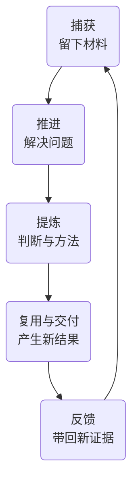

# Edges

[](https://www.npmjs.com/package/@viruspc/edges) [](https://coderabbit.ai)

**harness 任何目录。你的大脑，也是一个目录。**

*Harness any directory. Your brain is one too.*

和 Agent 一起工作时，许多有价值的东西留在了聊天里：一个方案为什么被放弃，一次纠正适用于什么情况，一件事做到哪里，以及下次可以复用的方法。换个会话，这些背景又要重新解释。

Edges 把这些经验组织成**跟随目录、由 Git 管理的工作记忆与协作方法**。讨论留下理由，任务留下目标，实践留下方法。下一个 Agent 可以沿着索引找到相关材料，接着推进；你可以阅读、修改、审阅它们，也可以带着它们换工具。

它可以用于一个代码库、一个持续推进的项目，或你自己的第二大脑。为一个目录配置的这套维护材料，就是它的 **harness**；把大脑看作一个虚拟目录，它的 harness 也可以放进自己的仓库。

[开始使用](#开始使用) · [设计思考](#为什么这样设计) · [模块与用例](#模块的设计与用例) · [公开实践](#公开实践) · [文档导航](#文档导航)

## 为什么这样设计

### 经验放在离问题最近的地方

一个项目的共同约定适合放在根，某个子模块的特殊限制适合留在那个目录。Edges 允许你为选定目录建立局部 harness，各层通过索引连接；Agent 从当前问题所在的作用域出发，读取相关层的约束，再按索引选择需要的材料，减少每次塞进上下文的无关背景。

这样，经验的归属和适用范围都能被看见。团队约定随团队仓库共享，个人方法留在自己的仓库；跨目录复用通过引用与组合完成。详细理由见[按作用域确定内容归属](docs/adr/0024-scope-first-content-ownership.md)。

### 用普通文件积累，用 Git 管理版本与共享范围

笔记、任务、记忆和技能以 Markdown 保存，正文与附件放在同一内容目录中。组织关系写在索引里，变化可以用 diff 检查、用 Git 追溯。跟踪与忽略规则也决定哪些材料进入共享版本、哪些仅留在本机。核心内容管理只需要 Node.js、Git 和 Edges CLI；观测后端、评测服务与在线预览按需要接入。

目录中既有正在做的工作，也有帮助你维护和改进它的经验。`README.md` 组织内容，`AGENTS.md` 引出维护信息，`.harness/README.md` 汇总该层材料。这套结构可以继续用于维护 Edges 自身。入口分工见[递归系统设计](docs/adr/0029-recursive-system-two-entries.md)与[材料索引](docs/adr/0035-harness-readme-as-layer-material-index.md)。

### 让方法和内容跨 Agent 延续

Edges 提供 CLI、Skill、MCP 三种接入方式：CLI 执行操作，Skill 告诉 Agent 何时及如何使用，MCP 为相应宿主提供工具入口。它们围绕同一套内容与操作契约工作，各入口已覆盖的能力见[CLI](packages/cli/README.md)、[Skills](packages/skills/README.md)和[MCP](packages/mcp-servers/README.md)。

你可以在不同会话和客户端之间接续工作。接入时需要让 Agent 能找到工作目录及其入口；经验的长期归属由仓库决定。这个选择的背景见[能力面设计](docs/adr/0004-capability-surface-cli-skill-mcp.md)。

### 让反馈改善下一次工作

值得复用的判断可以从一次实践中提炼出来，成为 **Edge**——带着理由和适用边界、能帮助未来行动的判断优势，Edges 由此得名。它可以再次用于工作，也可以发展成报告、文章、教学或工具。

Agent 可以把纠正写成记忆，把重复成功的做法整理成技能；人通过对话或 Git diff 审阅这些变化，观测与评测再提供改进的依据。积累的价值体现在下一次工作少走弯路、判断更有根据。这也是 Edges 实践持续自我改进的方式。



这张图描述经验如何循环；你可以从任何需要的模块开始，按实际工作组合它们。

## 模块的设计与用例

十个模块各自解决不同的问题。Notes、Projects、Tasks 承接材料与工作；Memory、Skills 保留经验与方法；Compose、Routines 支持复用与持续运行；Observation、Evaluation、Artifacts 帮助检查过程、验证效果和审阅产物。

### Notes · 先把值得保留的东西留下

捕获时往往还没有明确目标或成熟结论。Notes 让一次讨论、阅读或试验先有落点，保留背景和来源，之后再决定是否值得继续研究、提炼或行动。

**用例：** 调研两个方案后，先记下比较过程、证据与疑问。下一次需要选择时，可以回到原材料继续判断。[笔记用法](packages/cli/README.md#笔记notes)

### Projects · 围绕目标持续组织材料

一项持续推进的工作会产生资料、方案、实验和交付物。Projects 为它们提供共同的上下文与归属，让后续工作能找到此前的积累。项目内容可以与任务、笔记相互引用；任务看板里的 Task Project 则负责给任务分组。

**用例：** 为一次产品调研建立项目，把访谈材料、备选方案与报告放在一起，再用 Tasks 跟进需要完成的动作。[项目用法](packages/cli/README.md#项目projects)

### Tasks · 让目标跨会话接力

任务保存背景、目标、状态和完成标准，一次执行尝试则由 Run 区分。目标因此可以持续存在，在失败、暂停或换人之后继续推进。开卡时先留下背景与目标，澄清后再补齐可核验的完成标准。

**用例：** 手机上记下一个想法，桌面上与 Agent 澄清范围，再交给下一次会话实施；接手者能知道为什么做、进展如何、怎样算完成。[任务用法与 Run 查询](packages/cli/README.md#任务tasks)

### Memory · 留住未来判断仍然需要的理由

项目记忆保存当前代码或文件无法直接说明的东西：为什么选了这个方案、哪些做法被纠正过、哪些限制必须继续遵守。记忆归到最相关的作用域，检索时先看索引与说明，再读取需要的正文。

**用例：** 一次实现因兼容性问题放弃某个方案，留下理由和适用条件；后来另一个 Agent 改同一模块时，可以先检索这段经验。[记忆用法](packages/cli/README.md#项目记忆memory) · [检索方式](packages/skills/project-memory-ask/SKILL.md)

### Skills · 把有效做法变成可重复的方法

重复工作值得保留的不只是结果，还有执行步骤、判断条件和检查方式。Skills 把这些整理成 Agent 可以调用的方法。受管技能由本作用域维护正文；引用技能在原处维护，这里保留发现入口。这样，持续改进方法时能找到负责维护的原文，跨目录复用也无需另养一份副本。安装到 Agent 与登记到作用域索引分别完成。

**用例：** 把多次复盘后稳定下来的流程沉淀为技能，换 Agent 时仍能沿用，并在使用反馈中继续改进。这里管理的是可复用方法；教 Agent 操作 Edges 各模块的接入 skill 也属于技能的一种用途。[技能用法](packages/cli/README.md#技能skills)

### Compose · 分别维护，按需组合

个人经验、团队规范和项目知识有不同的共享范围、维护者与版本。Compose 通过 Git submodule 将外部仓库接入当前工作区，并登记各自用途，让它们能被发现和复用，同时保留原有归属与历史。

**用例：** 新项目组合一份团队工程规范和一份个人常用方法，项目自己的决策仍留在本地；更新共享规范时，可以明确选择引用的版本。[组合用法](packages/cli/README.md#组合仓库compose) · [为什么采用 Git submodule](docs/adr/0042-compose-on-git-submodule.md)

### Routines · 让例行工作的做法持续改进

例程分别记录日程与执行方法。仓库保存定义和 Skill，外部平台负责触发；每次运行前读取仓库中的记录与方法，默认采用默认分支最新内容，也可以固定版本。这样，改进后的做法有一个持续维护的来源。

**用例：** 每天由平台触发复盘。改进复盘 Skill 并合入默认分支后，下次按约定读取它；若改了日程，还需要同步调整平台配置。创建例程记录后，要完成平台接入才会定时执行。[例程用法与接入约定](packages/skills/edges-routines/SKILL.md)

### Observation · 看见真实工作是怎样发生的

改进需要知道 Agent 实际读了什么、调用了什么、在哪里遇到问题。Observation 保留运行轨迹与指标，用来回看真实使用过程。当前提供 Agent 轨迹接入与相关运行记录，可按客户端选择 Langfuse 接入方式。

**用例：** Agent 给出了错误结论，沿着轨迹查看它是否读到必要材料、工具是否失败，再决定应该改记忆、方法还是工具。[观测说明](packages/observation/README.md) · [选择轨迹接入方式](packages/skills/langfuse-agent-tracing/SKILL.md)

### Evaluation · 检查改进有没有带来效果

同一批题、可复查的配置与对照实验，让不同方案能够比较。Evaluation 提供检索和记忆等实验及报告，用来检验一次修改的效果；跑通评测链路之后，还需要合适的对照与证据来判断收益。

**用例：** 修改记忆检索方法后，用固定题集比较结果与成本，检查是否改善了目标问题，并保留报告供后续复跑。[评测用例](packages/evaluation/README.md) · [从 Langfuse 发起实验](packages/services/evaluation/README.md)

### Artifacts · 把阶段产物交给人审阅

交互页面、方案预览和分类建议需要一个方便打开的落点。Artifacts 为静态产物提供临时托管与可分享的 URL，适合跨设备审阅；页面渲染、发布以及结果写回各有自己的步骤。

**用例：** Agent 生成任务分类建议页，发布后在手机上审阅，再将确认结果交给 Agent 落库。临时链接按生命周期清理，长期站点另行维护。[预览发布用法](packages/cli/README.md#预览发布artifacts) · [服务说明](packages/services/artifacts-preview/README.md)

## 一次工作怎样留下下一次的起点

假设你要改善一个项目的入门体验。先用 **Notes** 保留用户反馈，用 **Projects** 集中访谈、方案和产物，再用 **Tasks** 明确要解决的问题与完成标准。

实施时，Agent 查阅 **Memory** 中之前的取舍，调用 **Skills** 中已有的方法；**Compose** 让它能找到共享的工程规范。阶段方案通过 **Artifacts** 交给人审阅，使用过程通过 **Observation** 回看，需要比较效果的改动用 **Evaluation** 验证。

交付之后，将新证据与用户反馈再次捕获，提炼值得长期保留的记忆或技能。若这类回看需要定期进行，可以用 **Routines** 记录方法与日程，接入执行平台。下一次工作因此有了更好的起点。

这是模块组合的一个例子。一次简单笔记只需要 Notes，一项小改动也可以从 Tasks 与 Memory 开始。

## 开始使用

### 让 Agent 帮你接入

把下面这句话发给你的 Agent：

```text
读 https://raw.githubusercontent.com/VirusPC/edges/main/packages/skills/edges-onboarding/SKILL.md ，帮我接入 edges。
```

接入流程会检查 Node.js 与 Git，在你选择的目录初始化，并验证内容能写入和读回。让 Agent 在这个目录工作，并加载该目录的 `AGENTS.md`，即可沿入口发现相关材料。客户端配置方式见[接入技能](packages/skills/edges-onboarding/SKILL.md)。

### 手动开始：保存第一条笔记

需要 **Node.js 22.20 及以上**和 **Git**。在你想使用 Edges 的项目或知识目录中执行：

```bash
npm install -g @viruspc/edges
cd <你的目录>
edges --scope . init -- -g -y

edges --scope . notes create --title "第一条笔记" --body "记下一次尝试和所得。"
edges --scope . notes list
```

默认初始化 Memory、Skills、Notes、Projects。`--` 后的 `-g -y` 将随包技能安装到用户 Agent 目录，并跳过安装确认。内容写在选定目录，本地内容变更可按你的 Git 流程审阅与保存。

### 再加一个任务看板

```bash
edges --scope . tasks init
edges --scope . tasks create --title "验证一个想法" --project default
edges --scope . tasks list
```

后续按需要采用其他模块：组合已有仓库用 [`edges compose`](packages/skills/edges-compose/SKILL.md)，记录例行工作用 [`edges routines init`](packages/skills/edges-routines/SKILL.md)。观测、评测与预览各有接入步骤，见上面的模块入口。完整命令见 [CLI 文档](packages/cli/README.md)或 `edges --help`。

## 公开实践

Edges 从作者长期的个人知识管理与 Agent 协作实践中发展而来。[公开个人 brain](https://github.com/VirusPC/edges-brain-viruspc) 保留了笔记、任务、教学与复盘；可以结合[教学站](https://edges.viruspc.tech/teaching/)与[任务看板](https://edges.viruspc.tech/tasks/)查看这些内容怎样被使用。

Edges 也用自己的记忆、技能与任务维护框架本身。公开使用记录能帮助理解设计从何而来，具体改进是否有效则由相应的评测报告与使用证据支持。

本仓维护框架；你的知识与工作材料放在自己的仓库，按需要通过 Compose 组合。源码布局、2026-10-20 拆仓历史与开发步骤见[贡献指南](CONTRIBUTING.md)。

## 文档导航

| 想了解什么 | 从这里开始 |
| --- | --- |
| 完整命令与作用域选择 | [CLI 文档](packages/cli/README.md) |
| Agent 怎样接入和调用 | [随包 Skills](packages/skills/README.md)、[MCP](packages/mcp-servers/README.md)、[system prompt 片段](packages/system-prompt/) |
| 概念与边界 | [领域术语](CONTEXT.md) |
| 某项设计为什么这样选 | [架构决策记录](docs/adr/) |
| 旧目录如何升级 | [布局迁移](docs/recursive-layout-migration.md) |
| 开发、源码布局与贡献约定 | [贡献指南](CONTRIBUTING.md)、[Agent 维护入口](AGENTS.md) |
| 最近发生了什么变化 | [Changelog](CHANGELOG.md) |

## 隐私与脱敏

本仓公开，贡献内容等同公开发表。凭据、个人敏感信息、未公开内部材料与办公文档不入库；涉及内部信息时先脱敏。完整规则与误提交处理见[贡献指南：隐私与脱敏](CONTRIBUTING.md#隐私与脱敏)。

## License

[MIT License](LICENSE)。

<!-- project-entries-local:start -->
## 本层内容

<!-- project-entries-local:end -->
