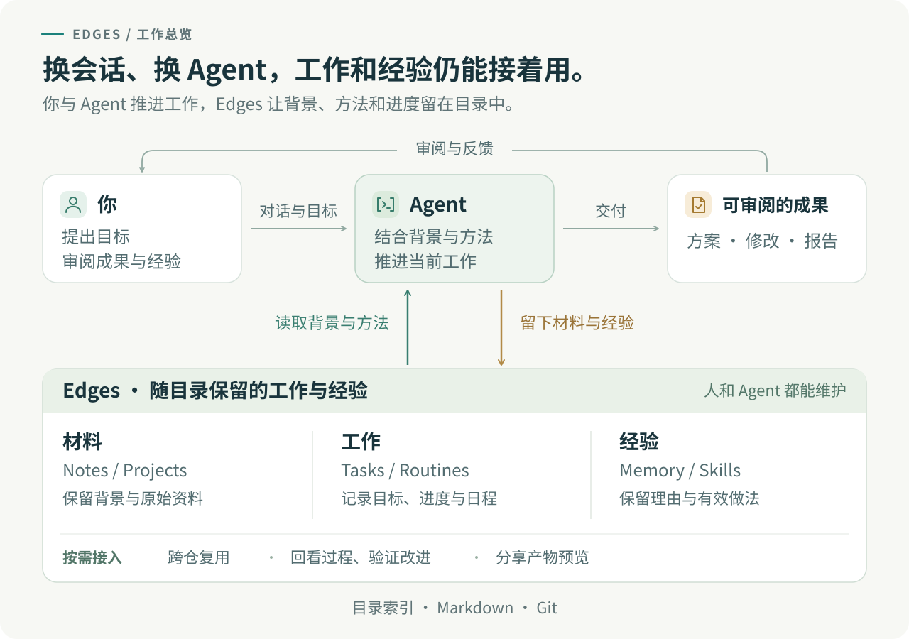
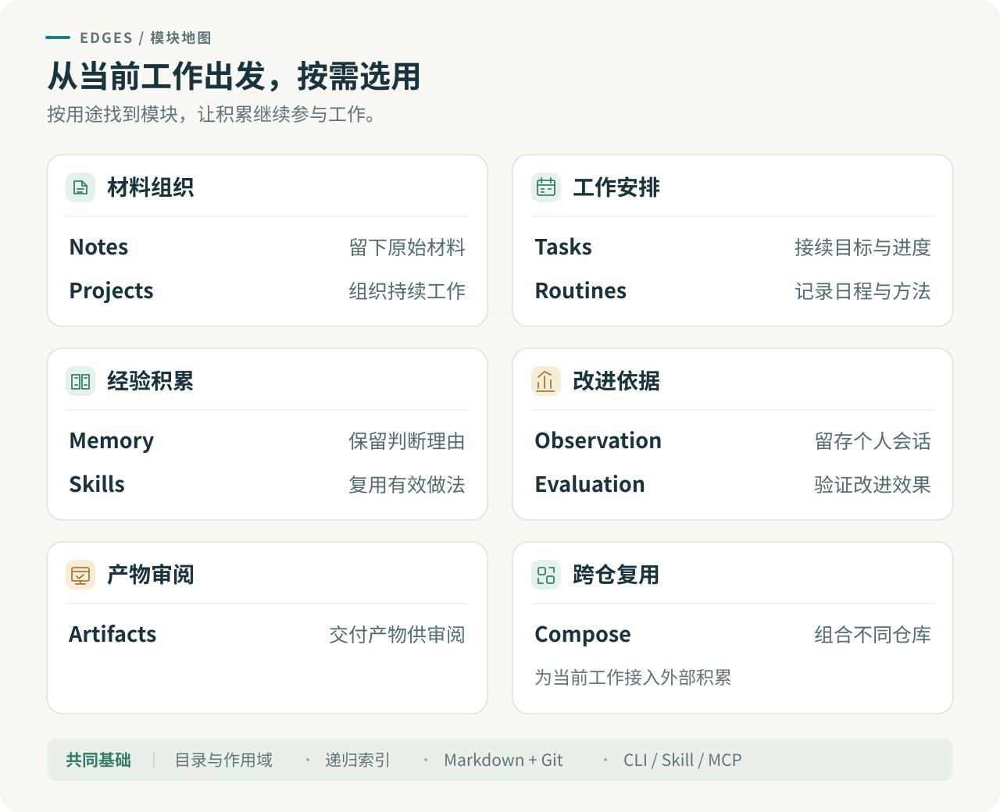
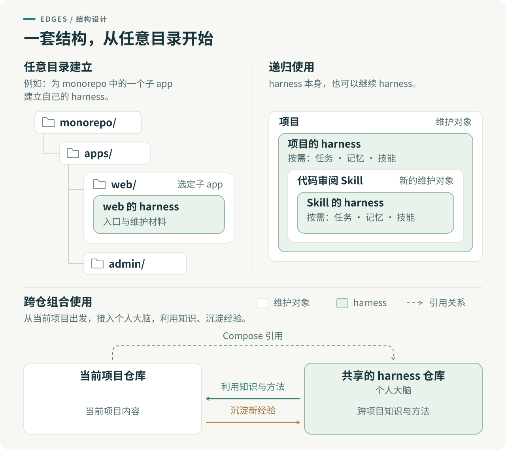
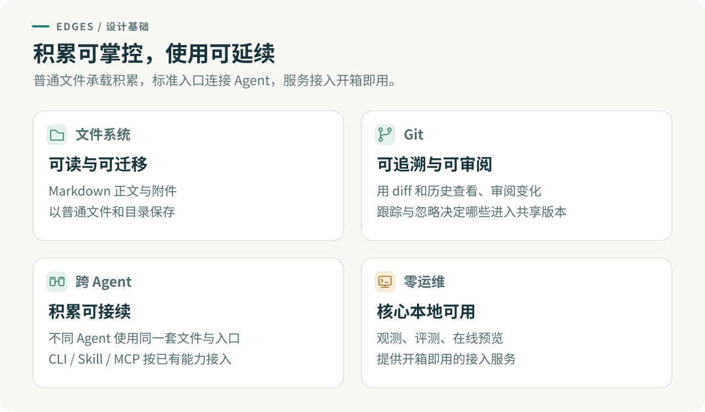

# Edges

[](https://www.npmjs.com/package/@viruspc/edges) [](https://coderabbit.ai)

**harness 任何目录。你的大脑，也是一个目录。**

*Harness any directory. Your brain is one too.*


[开始使用](#怎么开始) · [深入了解](#深入了解)

## 这是什么，能帮我做什么？

和 Agent 一起工作时，想做的改进、方案的取舍、做到一半的任务、下次可以复用的方法，常常留在聊天里。时间一久容易忘记，换个会话又要重新解释。

Edges 把它们组织成**跟随目录、由 Git 管理的工作记忆与协作方法**，让不同会话、不同 Agent 能找到已有积累，接着推进工作。围绕一个目录维护的这套材料，就是它的 **harness**；代码库、长期项目和个人大脑都可以拥有自己的一套。



## 为什么值得用？

Edges 识别出 Agent 协作中的关键工作，并为各模块打磨专门的组织方式与使用流程：Tasks 区分任务目标与执行尝试，Memory 按适用范围检索，Skills 保留可复用的步骤与判断。你可以按需组合这些模块，沿用已有的设计，再结合自己的工作持续改进。



经验留在适用的地方，方法本身也能被维护；各处独立积累，需要时再跨仓复用。



**想做的事有处安放，做到一半的工作能够接续。** 想到一个改进，可以先留下想做什么和缘由；有时间再沿着已有背景继续推进。普通文件与 Git 让积累可读、可迁移、可审阅，任务背景、目标与执行记录也能供后续会话和其他 Agent 接续。



**自己的 harness 有没有用，看得见，也测得出。** 记录不同 Agent 下的个人会话，分析日常工作与 harness 的使用情况，找出需要改进或清理的内容；再用自己的材料和问题开展对照评测，衡量质量与成本，让取舍有依据。

## 怎么开始？

把下面这句话发给你正在使用的 Agent：

```text
读 https://raw.githubusercontent.com/VirusPC/edges/main/packages/skills/edges-onboarding/SKILL.md ，帮我接入 edges。
```

Agent 会检查环境，在你选择的目录初始化，并验证内容能写入和读回。让 Agent 在这个目录工作并加载 `AGENTS.md`，即可沿入口发现相关材料。[接入说明](packages/skills/edges-onboarding/SKILL.md)

接入后，直接通过对话使用：记下这次讨论、把想法整理成任务、查找过去的决策，或把有效做法沉淀为技能。你通过对话和成果审阅推进工作。

## 深入了解

按当前需要选择模块，展开查看它解决的问题、设计理由与典型用例。一次简单笔记可以只用 Notes，一项小改动也可以从 Tasks 与 Memory 开始。

<details>
<summary>Notes · 先把值得保留的东西留下</summary>

捕获时往往还没有明确目标或成熟结论。Notes 让一次讨论、阅读或试验先有落点，保留背景和来源，之后再决定是否值得继续研究、提炼或行动。

**用例：** 调研两个方案后，先记下比较过程、证据与疑问。下一次需要选择时，可以回到原材料继续判断。[笔记用法](packages/cli/README.md#笔记notes)

</details>

<details>
<summary>Projects · 围绕目标持续组织材料</summary>

一项持续推进的工作会产生资料、方案、实验和交付物。Projects 为它们提供共同的上下文与归属，让后续工作能找到此前的积累。项目内容可以与任务、笔记相互引用；任务看板里的 Task Project 则负责给任务分组。

**用例：** 为一次产品调研建立项目，把访谈材料、备选方案与报告放在一起，再用 Tasks 跟进需要完成的动作。[项目用法](packages/cli/README.md#项目projects)

</details>

<details>
<summary>Tasks · 留住想做的事，随时随地继续推进</summary>

想法出现时，先留下想做什么、为什么值得做，避免被日常事务淹没。有时间后，再逐步澄清范围、补齐完成标准并付诸行动。任务保存背景、目标和状态，Run 区分一次次执行尝试；已有背景与记录也支持跨会话、跨 Agent 继续推进。

**用例：** 手机上想到一个改进，先让 Agent 记下来；几周后在电脑前腾出时间，重新打开任务，沿着当时的背景讨论和实施。中途换一个 Agent，也能根据任务与执行记录继续做。[任务用法与 Run 查询](packages/cli/README.md#任务tasks)

</details>

<details>
<summary>Routines · 让例行工作的做法持续改进</summary>

例程分别记录日程与执行方法。仓库保存定义和 Skill，外部平台负责触发；每次运行前读取仓库中的记录与方法，默认采用默认分支最新内容，也可以固定版本。这样，改进后的做法有一个持续维护的来源。

**用例：** 每天由平台触发复盘。改进复盘 Skill 并合入默认分支后，下次按约定读取它；若改了日程，还需要同步调整平台配置。创建例程记录后，要完成平台接入才会定时执行。[例程用法与接入约定](packages/skills/edges-routines/SKILL.md)

</details>

<details>
<summary>Memory · 留住未来判断仍然需要的理由</summary>

项目记忆保存当前代码或文件无法直接说明的东西：为什么选了这个方案、哪些做法被纠正过、哪些限制必须继续遵守。记忆归到最相关的作用域，检索时先看索引与说明，再读取需要的正文。

**用例：** 一次实现因兼容性问题放弃某个方案，留下理由和适用条件；后来另一个 Agent 改同一模块时，可以先检索这段经验。[记忆用法](packages/cli/README.md#项目记忆memory) · [检索方式](packages/skills/project-memory-ask/SKILL.md)

</details>

<details>
<summary>Skills · 把有效做法变成可重复的方法</summary>

重复工作值得保留的不只是结果，还有执行步骤、判断条件和检查方式。Skills 把这些整理成 Agent 可以调用的方法。受管技能由本作用域维护正文；引用技能在原处维护，这里保留发现入口。这样，持续改进方法时能找到负责维护的原文，跨目录复用也无需另养一份副本。安装到 Agent 与登记到作用域索引分别完成。

**用例：** 把多次复盘后稳定下来的流程沉淀为技能，换 Agent 时仍能沿用，并在使用反馈中继续改进。这里管理的是可复用方法；教 Agent 操作 Edges 各模块的接入 skill 也属于技能的一种用途。[技能用法](packages/cli/README.md#技能skills)

</details>

<details>
<summary>Observation · 记录不同 Agent 下的个人会话</summary>

通过对应客户端的接入方案，Observation 留存已接入 Agent 下的个人会话与可用执行记录，作为分析自己日常工作的材料。回看这些数据，可以了解自己在做什么、哪些问题反复出现，并结合当前任务与实际文件判断 harness 是否仍然适用、哪些过时内容需要更新或移除。

**用例：** 回看一段时间的个人会话，发现 Agent 反复引用已经失效的约定，定位对应的 harness 文件，确认适用范围后更新或移除，再用评测检查调整的影响。[观测说明](packages/observation/README.md) · [选择会话接入方式](packages/skills/langfuse-agent-tracing/SKILL.md)

</details>

<details>
<summary>Evaluation · 检验自己的 harness 是否真正有用</summary>

用自己的材料和关心的问题构建评测，通过可复现的对照比较回答质量、规则遵守及 token、时间成本，判断一次修改是否改善了自己的工作。Evaluation 提供检索评测、记忆消融等实验与报告；跑通程序之后，需要匹配问题的题集与判分，才能判断实际收益。

**用例：** 同一个 Agent 回答同一批问题，比较有记忆与无记忆两个工作目录中的表现，检查回答是否更好、违反约束是否减少、成本增加了多少，再决定怎样调整记忆。[记忆消融实验](packages/evaluation/experiments/harness_memory_ablation/README.md) · [评测说明](packages/evaluation/README.md) · [从 Langfuse 发起实验](packages/services/evaluation/README.md)

</details>

<details>
<summary>Artifacts · 把阶段产物交给人审阅</summary>

交互页面、方案预览和分类建议需要一个方便打开的落点。Artifacts 为静态产物提供临时托管与可分享的 URL，适合跨设备审阅；页面渲染、发布以及结果写回各有自己的步骤。

**用例：** Agent 生成任务分类建议页，发布后在手机上审阅，再将确认结果交给 Agent 落库。临时链接按生命周期清理，长期站点另行维护。[预览发布用法](packages/cli/README.md#预览发布artifacts) · [服务说明](packages/services/artifacts-preview/README.md)

</details>

<details>
<summary>Compose · 分别维护，按需组合</summary>

在已有项目中工作时，可以通过 Compose 接入个人大脑。个人大脑仓库整体承担共享 harness 的角色，保存跨项目的知识与方法。Compose 通过 Git submodule 将它挂入当前工作空间；Agent 在推进项目时利用其中的积累，也将新的经验沉淀到大脑。两仓各自保留归属与 Git 历史。

**用例：** 在项目中挂入个人大脑，复用过去的调试方法；完成排查后，将可跨项目使用的经验沉淀到大脑，供下一次工作使用。[组合用法](packages/cli/README.md#组合仓库compose) · [为什么采用 Git submodule](docs/adr/0042-compose-on-git-submodule.md) · [挂载仓库的写入](docs/adr/0045-compose-checkout-writable.md)

</details>

<details>
<summary>设计依据与使用边界</summary>

**目录与作用域。** 一个项目的共同约定适合放在根，某个子模块的特殊限制适合留在那个目录。Edges 允许你为选定目录建立局部 harness，各层通过索引连接；Agent 从当前问题所在的作用域出发，读取相关层的约束，再按索引选择需要的材料，减少每次塞进上下文的无关背景。

这样，经验的归属和适用范围都能被看见。团队约定随团队仓库共享，个人方法留在自己的仓库；跨目录复用通过引用与组合完成。详细理由见[按作用域确定内容归属](docs/adr/0024-scope-first-content-ownership.md)。

目录中既有正在做的工作，也有帮助你维护和改进它的经验。`README.md` 组织内容，`AGENTS.md` 引出维护信息，`.harness/README.md` 汇总该层材料。当维护对象变成一套复盘技能或 harness 本身时，它也可以拥有自己的维护材料，记录这套方法的纠正、任务与改进。各层沿用同一结构，Edges 自身也用它来维护框架。入口分工见[递归系统设计](docs/adr/0029-recursive-system-two-entries.md)与[材料索引](docs/adr/0035-harness-readme-as-layer-material-index.md)。

**文件系统让内容可读、可迁移。** 笔记、任务、记忆和技能以 Markdown 保存，正文与附件放在同一内容目录中，组织关系写在索引里。你可以用常见编辑器阅读，用文件工具检索和备份；换工具时，已有材料仍可继续使用。

**Git 让变化可追溯、可审阅。** 一条经验为何修改，可以通过 diff 和历史回看；协作中的变化可以经过分支与 PR 审阅。跟踪与忽略规则决定哪些材料进入共享版本、哪些保留在本机，积累的版本与共享范围由你管理。

**跨 Agent 接入让工作可接续。** CLI 执行操作，Skill 告诉 Agent 何时及如何使用，MCP 为相应宿主提供工具入口。接手的 Agent 能沿项目入口读取任务背景、目标与已有执行记录，继续推进工作；接续依赖于能访问同一份最新材料。各入口的能力覆盖与接入方式见[CLI](packages/cli/README.md)、[Skills](packages/skills/README.md)和[MCP](packages/mcp-servers/README.md)，设计理由见[能力面设计](docs/adr/0004-capability-surface-cli-skill-mcp.md)。

**零运维，让 Agent 完成接入。** 核心内容通过本地 Node.js、Git 和 Edges CLI 管理，无需常驻数据库或服务器。[观测](packages/observation/README.md)、[评测](packages/services/evaluation/README.md)与[在线预览](packages/services/artifacts-preview/README.md)提供开箱即用的接入服务；CLI 已提供服务端启动能力，Agent 可以完成服务启动与客户端接入流程。

**经验怎样继续改进工作。** 值得复用的判断可以从一次实践中提炼出来，成为 **Edge**——带着理由和适用边界、能帮助未来行动的判断优势，Edges 由此得名。它可以再次用于工作，也可以发展成报告、文章、教学或工具。

Agent 可以把纠正写成记忆，把重复成功的做法整理成技能；人通过对话或 Git diff 审阅这些变化。个人会话记录为分析日常工作、识别过时的 harness 内容提供依据，评测用自己的材料与问题验证更新或清理的影响，再将有依据的改进用于后续工作。这也是 Edges 实践持续自我改进的方式。

</details>

### 公开实践

Edges 从作者长期的个人知识管理与 Agent 协作实践中发展而来。[公开个人 brain](https://github.com/VirusPC/edges-brain-viruspc) 保留了笔记、任务、教学与复盘；可以结合[教学站](https://edges.viruspc.tech/teaching/)与[任务看板](https://edges.viruspc.tech/tasks/)查看这些内容怎样被使用。

Edges 也用自己的记忆、技能与任务维护框架本身。公开使用记录能帮助理解设计从何而来，具体改进是否有效则由相应的评测报告与使用证据支持。

本仓维护框架；你的知识与工作材料放在自己的仓库，按需要通过 Compose 组合。源码布局、2026-10-20 拆仓历史与开发步骤见[贡献指南](CONTRIBUTING.md)。

### 文档导航

| 想了解什么 | 从这里开始 |
| --- | --- |
| 完整命令与作用域选择 | [CLI 文档](packages/cli/README.md) |
| Agent 怎样接入和调用 | [随包 Skills](packages/skills/README.md)、[MCP](packages/mcp-servers/README.md)、[system prompt 片段](packages/system-prompt/) |
| 概念与边界 | [领域术语](CONTEXT.md) |
| 某项设计为什么这样选 | [架构决策记录](docs/adr/) |
| 旧目录如何升级 | [布局迁移](docs/recursive-layout-migration.md) |
| 开发、源码布局与贡献约定 | [贡献指南](CONTRIBUTING.md)、[Agent 维护入口](AGENTS.md) |
| 最近发生了什么变化 | [Changelog](CHANGELOG.md) |

## 隐私与脱敏

本仓公开，贡献内容等同公开发表。凭据、个人敏感信息、未公开内部材料与办公文档不入库；涉及内部信息时先脱敏。完整规则与误提交处理见[贡献指南：隐私与脱敏](CONTRIBUTING.md#隐私与脱敏)。

## License

[MIT License](LICENSE)。

<!-- project-entries-local:start -->
## 本层内容

<!-- project-entries-local:end -->
