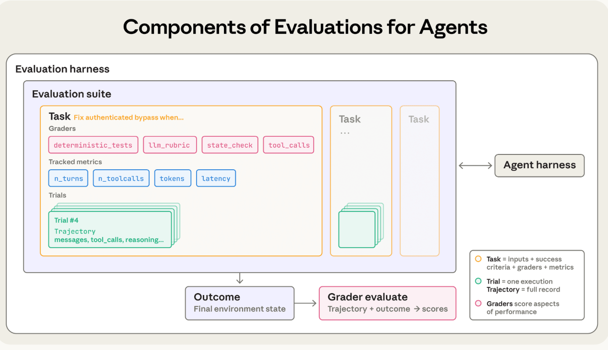
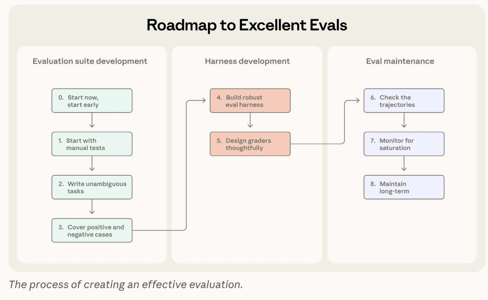

# 端到端评测方案调研

# 调研总览

- CursorBench：[CursorBench 技术报告（数据集未开源）](https://cursor.com/en-US/blog/cursorbench)，评测真实开发会话、线上效果

- Qoder：[记忆系统：让智能体从工具进化为搭档](https://qoder.com/zh/blog/qoder-memory-evolution)｜[工程知识引擎：Harness Engineering体系下的工程知识底座](https://qoder.com/blog/engineering-knowledge-engine)｜[智能体自主开发工作台：Qoder 1.0 重构任务执行环境](https://qoder.com/zh/blog/qoder-harness)

- 美团技术团队：[Agent评测漫谈 —— 由浅入深讲解Agent评测](https://tech.meituan.com/2026/08/07/Agent-Evaluation.html)，评测的是 agent 在业务场景中的能力

- METR：[2025 开发者效率研究](https://metr.org/blog/2025-07-10-early-2025-ai-experienced-os-dev-study/)｜[2026 研究](https://metr.org/blog/2026-02-24-uplift-update/)｜[公开数据和统计代码](https://github.com/METR/Measuring-Early-2025-AI-on-Exp-OSS-Devs)，需要人类研究院参与的实验，不属于评测

- SWE-Lancer：[SWE-Lancer 技术报告](https://openai.com/index/swe-lancer/) [swe-lancer 仓库](https://github.com/openai/frontier-evals/tree/main/project/swelancer)，评测的是真实商业软件开发任务

- WorkBuddy Bench：[WorkBuddy Bench 仓库](https://github.com/Tencent/workbuddy-bench)，评测的是真实岗位工作任务

- Codex Skill  Eval：[codex skill eval 技术报告](https://developers.openai.com/blog/eval-skills)，评测的是 agent skill 的效果、执行过程与产物

- Claude Code：（1）[mystifying Evals for AI Agents](https://www.anthropic.com/engineering/demystifying-evals-for-ai-agents)（2）[Harness Design for Long-Running Application Development](https://www.anthropic.com/engineering/harness-design-long-running-apps)（3）[An Update on Recent Claude Code Quality Reports](https://www.anthropic.com/engineering/april-23-postmortem)，评测的是Coding Agent 质量、regression 测试

- Langfuse：[Evaluating AI Agent Skills](https://langfuse.com/blog/2026-02-26-evaluate-ai-agent-skills)｜[Detect User Disagreement Workshop](https://langfuse.com/workshop/learner/04-monitoring)｜[Yes, You Can Copy Our Eval Setup](https://langfuse.com/blog/2026-07-16-steal-our-eval-setup)，分别测试 skill、用户反馈和整体测试流程，还有线上数据回流

- 字节：[PatchEval 仓库](https://github.com/bytedance/PatchEval)，评测的是真实漏洞修复

- 字节：[multi swe bench 仓库](https://github.com/multi-swe-bench/multi-swe-bench-env)[multi swe bench leaderboard](https://github.com/multi-swe-bench/experiments)，评测的是多语言真实仓库开发任务

- AHE 论文：[AHE 可观测性驱动评测 论文](https://arxiv.org/abs/2604.25850)｜[知乎解析](https://zhuanlan.zhihu.com/p/2035742012461273733)，主要是做了一个可观测、可迭代系统组件的框架

目前关于端到端的评测方案有很多，但大部分都是在预定义好的benchmark上的评测，是离线评测，且大部分是构造的任务，不是真实开发者的任务。实际业务中的价值评测方案不多，它需要：

- 数据来源于线上真实数据 —— 采集、回流线上数据成为评测数据

- 需要做 A/B 实验证明新版可以创造业务价值 —— 可比的在线对照实验

目前最接近的是 CursorBench 和 Qoder，有提到根据线上 A/B 实验的指标，比较不同版本 agent 的区别，但是没有公开的评测代码。

# CursorBench

> **2026.3-4 **[CursorBench 技术报告（数据集未开源）](https://cursor.com/en-US/blog/cursorbench) [Continually improving our agent harness](https://cursor.com/blog/continually-improving-agent-harness)

CursorBench 明确提出：离线 Benchmark 的好成绩不一定代表真实开发者体验更好，因此需要把离线评测和线上业务效果结合起来。

Cursor 使用内部真实开发会话构建 CursorBench。

**具体做法**是：

1. 通过 Cursor Blame 追踪实际提交的代码与最初的 Agent 请求之间的关联。

2. 从真实 Coding Agent 会话中提取开发任务，并以实际代码变更作为参考。

3. 在代码仓库中重新执行任务，由 Agent 生成对应修改。

4. 使用 Agentic Grader 判断任务的实现正确性。

5. 对不同模型、Harness 版本进行重复评测。

相较于 SWE-bench，CursorBench 保留了真实用户描述需求时简短模糊的特征，并包含更复杂的跨文件开发任务。

**评测指标**

1. 产出质量：

  1. **Solution Correctness**：生成的代码是否正确

  2. **Code Quality**：生成的代码质量

2. 用户行为：

  1. **Keep Rate**：看 agent 生成的代码修改，在经过固定时间间隔后，有多少仍保留在开发者的代码库中。它关注开发者接受结果后有没有继续保留。如果生成的代码后来被大量删改，就可能意味着最初的回答质量存在问题

3. 用户反馈：

  1. **用户对 agent 回复的满意度**：使用 LLM 根据用户对 agent 初始输出的后续回复，判断用户是否满意。如果用户直接继续下一个功能：较强的任务完成信号；如果用户粘贴报错堆栈：较强的失败信号

4. 执行效率：

  1. **Latency**：宏观来看是完成任务所需时间，更细地可以看每一轮模型生成耗时、工具调用耗时

  2. **Token Efficiency**：：使用的 Token 总量

  3. **Tool Call Count**：调用工具的次数

5. 基础设施：

  1. **Cache Hit Rate**：衡量 agent 在调用模型时，已有上下文缓存被重复利用的比例，越高说明成本和延时更低

  2. **Tool Error Rate**：衡量 agent 执行开发任务时，工具调用返回 error 的比例，并且对工具错误进行分类，包括传参错误、运行环境错误、工具服务商错误、用户主动中断、执行超时等，可以量化工具调用的可靠性和 agent 对工具的使用能力

6. 线上效果：

  1. **多指标综合观察的 online A/B experiment**：在真实用户场景中，对比不同版本 agent 的实际表现，用的指标是上述所有指标，对比两个版本 agent 的整体区别

Cursor 公开过代码检索有关的消融实验：[直接移除 Semantic Search 工具](https://cursor.com/cn/blog/semsearch)，通过线上对照来定位哪些场景真正受益于语义检索。报告指出，较大代码库中的仓库知识问答属于收益比较明显的场景。

另一个案例是上下文总结：Cursor 曾测试更昂贵的模型进行 Context Summarization，但线上质量增益不足以抵消增加的成本。

---

# Cursor

> [How We Compare Model Quality in Cursor](https://cursor.com/blog/cursorbench)

Cursor 的线上实验方法旨在解决 Coding 场景特有的问题：**一条真实用户开发请求，怎样找到它最终对应的代码修改结果？**

首先，**Cursor 通过 Cursor Blame 建立关联**，将实际提交的代码追溯到产生这些代码的 Agent 请求，从而建立：

```text
真实用户开发请求
          ↓
Agent 执行会话（读取文件、检索、编辑、测试）
          ↓
最终提交的代码（经过开发者后续处理并提交的修改）
          ↓
CursorBench 评测样本（任务输入与参考实现关联）
```

这样 Cursor 能够获取真实开发需求及其对应的参考解决方案，不用人工编造所有任务。Cursor 还说明，其内部任务集会周期性更新，以适应开发者使用 Agent 的方式变化。

**Cursor 怎样处理 Ground Truth？**

Cursor 将真实提交的代码作为参考解决方案，但并不要求待评测 Agent 必须生成完全一样的 Patch，因为同一个开发需求往往可以存在多种正确实现。因此 Cursor 是通过 model grader 评价 Agent 生成的解决方案，同时考虑实现正确性、代码质量和交互表现。

**优势**：

- 可以从真实开发记录中找到参考实现。

- 不必强制 Agent 复刻历史开发者的具体实现步骤。

目前 Cursor 已公开任务构建思路、任务来源、部分评测维度以及离线和线上指标之间的比较分析。但是用于定位真实代码的 Cursor Blame 算法未开源，所有代码均未完整开源、对话切分、评测机制和初始化也都没有开源

---

# Qoder

> 2026.3–5 [记忆系统：让智能体从工具进化为搭档](https://qoder.com/zh/blog/qoder-memory-evolution)｜[工程知识引擎：Harness Engineering体系下的工程知识底座](https://qoder.com/blog/engineering-knowledge-engine)｜[智能体自主开发工作台：Qoder 1.0 重构任务执行环境](https://qoder.com/zh/blog/qoder-harness)

Qoder 讨论了 Memory / 工程知识能力是否改善 Coding Agent 在实际开发过程中的表现。

**如何评测**

Qoder 介绍两种**评测方法**：

1. **离线记忆测评**：针对记忆生成、检索以及记忆是否真正生效，构建内部 code 场景测试集，包括项目架构理解、开发规范遵循与技术栈适配三种场景，观察 agent 的最终任务质量与资源消耗。

2. **线上业务评测**：基于真实 coding agent 会话，比较 memory 启用与不启用、或召回记忆被实际使用与未被使用时的业务结果，按具体场景分组统计。

在记忆生效判断上，官方描述了这样一个中间步骤：**当 memory 被召回后，再由模型判断它是否实际影响了当前输出**，随后结合会话所属场景比较：**不满意率、保留率、Token 与对话轮次**

**离线评测指标**

内部 Memory Benchmark 覆盖 5 类记忆产生场景、26 个细分类别。其中五个场景包括项目初始化、代码采纳、会话结束后的信息提炼、跨会话模式抽象、用户显式记忆操作，评测维度包括：

- 记忆生成质量：是否从代码、对话和执行过程提取正确、有用的项目与用户信息，衡量历史经验是否被正确沉淀

- 记忆检索质量：当前任务需要历史信息时，是否找回相关记忆，衡量是否能为任务提供相关上下文

- 记忆生效：被召回的内容是否真正影响 Agent 最终输出，衡量记忆是否进入实际任务决策，而非仅被检索到

**线上 Memory A/B 指标**

在同一批线上场景中比较 Memory 生效与未生效的情况，使用**三天线上数据、Top 5 场景类目**，评测指标如下：

- 用户不满意率：衡量用户是否对 agent 交付的回答或开发结果表达不满意

- 代码保留率：衡量 agent 生成的代码有多少在后续开发中被保留

- 输入 Token：衡量任务或会话中 agent 的输入 token 消耗

- 对话轮次：衡量从提出任务到完成交互所需要的对话轮次

还有两个监控指标：

- Session Engagement：在启用 Memory 的会话中，有多少会话实际触发了 memory 使用。

- Memory Effectiveness：召回的记忆中，有多少被判定为真正影响了输出。

---

# GitHub Copilot

> [业务指标字段](https://docs.github.com/en/copilot/reference/copilot-usage-metrics/copilot-usage-metrics)｜[PR 指标更新](https://github.blog/changelog/2026-02-25-org-level-metrics-api-now-includes-pull-request-throughput-metric-parity/)｜[人工 Review Cycle 指标更新](https://github.blog/changelog/2026-07-07-add-review-cycles-and-time-to-adoption-phases-in-the-usage-api/)

GitHub 已将部分研发业务指标产品化，通过 API 提供明确字段。以下的 PR 均指成功的 PR，

**PR 指标**：同时观察 Agent 的交付数量和完成速度

- **pull_requests.total_created_by_copilot**：Copilot Coding Agent 创建的 PR 数量

- **pull_requests.total_merged_created_by_copilot**：Copilot 创建且最终被合并的 PR 数量

- **pull_requests.median_minutes_to_merge_copilot_authored**：Copilot 创建的已合并 PR，从创建到合并的中位时间

- **pull_requests.total_merged**：报告日期中全部已合并 PR 数量

- **pull_requests.median_minutes_to_merge**：全部已合并 PR 的创建至合并时间中位数，不用均值是为了减少特别长的 PR 对结果的影响。

**人工 Review Cycle 指标**：GitHub 还公开了：

- **total_copilot_suggestions**：Copilot Code Review 提出的修改建议数

- **total_copilot_applied_suggestions**：被实际采纳的 Copilot Review 建议数

- **median_minutes_to_merge_copilot_reviewed**：接受过 Copilot Review 的已合并 PR 的合并周期

- **avg_pull_requests_review_cycles**：对应 AI 使用分组中的 PR Review 轮次

- **avg_pull_requests_minutes_to_review**：PR 创建至首次 Review 的时间统计

GitHub 在 2026 年 7 月新增了按 AI Adoption Phase 进行 Review 效率比较的能力，让组织能够观察不同使用深度的开发者在 PR 交付速度、Review 循环次数等方面的差异。

关于这些指标怎样体现业务价值，可以理解为它们把 Agent 的活动连接到了真实研发流程中的几个重要事件：

1. **PR Created**：Agent 产生了可供审核的代码交付物。

2. **First Review**：进入真实研发团队的审核流程。

3. **Review Cycles**：为达到交付标准经历多少轮审核。

4. **PR Merged**：代码最终被团队接纳并合并。

5. **Time to Merge**：从创建到完成合并需要多长时间。

Agent 自动创建大量 PR，并不意味着研发效率一定提高，因为人工审核可能成为新的瓶颈。同样，PR 最终被合并，也不保证上线后永远不会出现 Bug，因此这些仍是具有业务意义的代理指标，而不是完整质量证明。

GitHub 文档**明确说明**：

- PR 合并时间以最终合并的 PR 为统计对象。

- 没有合并的 PR 不参与对应的时间统计。

- 使用 Median 而非 Mean，减少特别长的 PR 对结果的影响。

- 某些 Review 轮次和延迟指标按 PR 的合并日期归属。

这意味着**只比较成功合并的 PR，可能忽略被关闭、放弃或长期卡住的任务。**

---

# Microsoft Foundry

> [Convert agent traces into evaluation datasets](https://learn.microsoft.com/en-us/azure/foundry/observability/how-to/traces-to-dataset?tabs=python)｜[Python SDK 完整示例](https://github.com/Azure/azure-sdk-for-python/blob/main/sdk/ai/azure-ai-projects/samples/datasets/sample_dataset_generation_job_traces_for_evaluation.py)

公开了具体的数据选择、清洗与版本化实现，是针对**线上数据回流**找到的最直接的工程实现之一。

**数据选择**

Microsoft Foundry 不只是把已有的 Trace 导出成 JSON，而是提供 Data Generation Job，直接将生产 Trace 加工为版本化 Dataset。

官方文档明确公开了 Intelligent Sampling 的两项处理：

- **低价值流量过滤**：过滤单字符输入、明显缺少用户意图的请求等不适合作为评测任务的记录。

- **多样性采样**：使用 MinHash 降低近重复样本的比例，避免大量高度相似的用户输入占满评测集。

**回流流程**

1. **生产环境 Traces**：基于 Agent、版本、时间窗口、Trace ID 选择。

2. **数据筛选**：过滤低价值流量，MinHash 多样性采样。

3. **隐私处理**：默认对 Trace 中的私有内容进行脱敏。

4. **数据集生成**：提取 Query / Response 等评测字段。

5. **版本化存储**：创建新 Dataset Version，支持 Merge 或 Overwrite。

6. **离线 Evaluation**：指定固定 Dataset 版本执行评测。

特别的是，Microsoft Foundry 还进行了**数据版本控制**，官方提供两种写入模式：

- OVERWRITE：基于本次处理结果创建新版本，不改变已经存在的历史版本。

- MERGE：将新样本合并到现有最新版本，并对重复的 Trace 行进行去重，同样生成新版本。

文档还特别建议固定 agent_version，否则一次数据抽取可能混合多个线上 Agent 版本的行为，影响评测结果的可比性。

**优势**：Microsoft Foundry 比较完整地解决了数据采集、清洗、去重、隐私处理、评测集存储和版本管理。

**局限**：处理的是通用 Agent 的会话记录，最终生成标准 QA 的评测数据。目前还没有自动恢复 Coding Agent 执行任务时的 Git Commit、完整工作区、历史 Memory 状态，也没有自动为代码开发任务生成可靠的功能测试。

---

# 美团技术团队

> [Agent评测漫谈 —— 由浅入深讲解Agent评测](https://tech.meituan.com/2026/08/07/Agent-Evaluation.html)

**如何评测**

首先构建了**分层评测体系**：

- 浅层：原子能力评测，不做完整任务，只拆解评测 agent 的单项能力。例如单独测试意图识别是否准确、function calling 的 JSON 格式生成率、记忆召回率等。

- 中层：过程轨迹评测，关注 agent 执行任务的中间过程。将 agent 的每一步操作轨迹与人类专家的参考轨迹进行比对，看它是否在按正确的逻辑推理和调用工具。

- 深层：端到端任务评测，把 agent 放入真实业务场景中，给定一个高阶目标，比如帮我订一张明天去北京的机票，让 agent 自主规划执行，最终看任务是否完成。

然后是**评测方法**：

- code-based：使用 assert 检查最终状态

- model grader：使用 LLM 作为裁判，设计 Prompt，根据预设的 rubrics 对 agent 的推理过程和最终结果进行打分

- 对抗生成测试：自动生成边缘测试用例或陷阱，测试 agent 的鲁棒性

> 在制定 rubrics 时，核心是“人人一致（降低方差）+ 人机一致（机评与人评一致的时候才可信）”。
>
> 具体方法是把模糊概念细分成 rubrics，并且每个 rubric 尽量二元化，rubric也会不断迭代，根据 unknown 占比、人人一致率、人机一致率判断 rubric 是否合理。
>
> 在实践中，他们一开始只定义了少量关键指标，然后不断从线上收集 bad case、沉淀 good case，将他们作为评测样本，评测结果反哺调整 prompt、skill，再从新线上抽样，不断迭代形成飞轮

图示要点：人人一致用于降低评测方差；高方差会使真实提升与指标波动难以区分；统一评测标准有助于降低偏差。


最后是**评测环境**，因为 agent 需要和真实世界交互，但是真实世界中工具调用成本高且不稳定，所以构建了**仿真沙盒环境用于评测**：

- 模拟美团 APP 的内部接口，让 Agent 在沙盒里执行搜索、下单、支付等动作，环境会根据 Agent 的动作给出真实反馈，但不会产生真实交易。

**评测指标**

1. 原子能力指标

- 工具调用准确率：

  - 工具选择准确率：在给定场景下，选对正确工具的比例。

  - 参数填充准确率：生成的调用参数与 ground truth 的匹配度。

  - 格式合规率：生成的 JSON 或代码能否被成功解析。

- 规划合理性：任务拆解的步骤是否多余、是否有逻辑遗漏。如果有 ground truth，那么会用图论的编辑距离和轨迹重合度计算；如果没有 gt，从精简性和完备性出发用 LLM 打分。

2. 过程轨迹指标

- 轨迹匹配度：agent 实际执行路径与人类专家标准路径的重合度。

- 动作有效率：有效动作 / 总动作。剔除那些无意义的试探、死循环或重复调用。无效动作的定义是：

  - 重复调用：连续 N 次调用，传参和返回结果基本一致

  - 语法错误

  - 环境报错且未恢复：调用了不存在的工具，或者超时、越界，返回 error

  - 无意义：如果返回结果在后面没有被用上【上下文追踪】，或是若有 gt，偏离 gt 中规定动作的就属于无意义【过于严格，会抑制 agent 探索】

- 错误恢复率：当 agent 调用工具失败或遇到异常时，能否自我反思并采取补救措施重新走向成功。

3. 端到端指标

- 任务成功率：最核心的指标。完成全部任务要求且结果正确的测试用例占总用例的比例。

- 子目标完成率：一般每个子目标完成会对应一次环境变化，通过沙盒埋点和 assert 检查状态来计算有多少子目标完成。子目标在构建数据集时就已经定义【要拓展该指标到其他数据集，需要做数据增强，划分子目标】

- 幻觉率：agent 编造不存在的工具、捏造 API 返回结果的比例。

4. 效率成本指标

- 平均交互轮数：完成一个任务平均需要多少轮 Thought-Action-Observation。轮数过多说明 agent 效率低下或经常走弯路。

- Token 消耗量：完成单次任务消耗的 Prompt + Completion 总 Token 数，关系到推理成本。

- 端到端延迟：从用户输入到 Agent 完成任务反馈的总耗时。

---

# **METR**

[2025 开发者效率研究](https://metr.org/blog/2025-07-10-early-2025-ai-experienced-os-dev-study/)｜[2026 研究](https://metr.org/blog/2026-02-24-uplift-update/)｜[公开数据和统计代码](https://github.com/METR/Measuring-Early-2025-AI-on-Exp-OSS-Devs)

METR 的研究不属于 Agent 自动执行 Benchmark，而是直接测量 AI 工具对真实开发人员完成任务所需时间的影响。

2025 年的研究让 16 名熟悉自己代码仓库的开源开发者完成 246 项开发任务，随机分配是否允许使用 AI 工具，并记录实际完成时间。当时的研究发现，允许使用 AI 的任务平均反而需要多约 19% 的时间；但参与者主观上认为自己更快。

2026 年 2 月，METR 发布后续研究，指出新工具可能已经改善开发效率，但新实验受到参与者选择偏差、拒绝禁用 AI 和并行使用多个 Agent 等因素影响，无法可靠估计新的真实加速幅度。

METR 的价值在于它严格区分了**开发者主观感受、Agent Benchmark 表现和实际任务完成时间**三类评价对象。

---

# SWE-Lancer

> 2025.2 [SWE-Lancer 技术报告](https://openai.com/index/swe-lancer/) [swe-lancer 仓库](https://github.com/openai/frontier-evals/tree/main/project/swelancer)

**如何评测**

SWE-Lancer 不仅评测 agent 能否完成任务，还尝试用真实商业任务的报酬衡量软件工程能力的经济价值，收集了超过 1400 个 Upwork 软件开发任务，涉及价值合计约 100 万美元的真实项目。

任务分成两种：

- **Independent Engineering**：实际修复 Bug、实现功能、优化性能、开发前端等。

- **Engineering Management**：在多个技术实现方案中做出选择。

**评测指标**

- **任务成功率**：Pass@1，IC SWE 要求生成的代码通过全部适用的端到端测试；SWE Manager 要求选中的技术方案与原始工程经理的选择一致，衡量 agent 首次尝试完成真实软件工程任务的能力。

- **获得的任务报酬**：Dollars Earned，将 agent 成功完成的任务对应的真实历史报酬相加；失败任务记为 0，不给予部分报酬，衡量 agent 成功完成的开发任务对应多少经济价值。

- **报酬获取率**：Earn Rate，agent 成功任务的报酬总额 ÷ 全部评测任务的报酬总额 × 100%，衡量 agent 完成的任务占总经济价值的比例。

- 多次尝试成功率：Pass@k，衡量增加尝试次数是否提高任务成功率

- 成本节约率：Cost Savings，假设先使用 AI，失败任务再交给人类开发者，比较这一流程与全部由人类完成时的总成本，衡量使用 AI 后实际能节省多少开发成本。

- 模型贡献比：Model Contribution Ratio，成功任务对应的总报酬 ÷（全部模型调用成本 + 失败任务的人类开发成本），衡量相对于 AI 与人工总投入，AI 完成的任务具有多少经济价值。

前三项是主指标，后三项是用于扩展实验和经济分析的指标。

---

# WorkBuddy Bench

> 2026 [WorkBuddy Bench 仓库](https://github.com/Tencent/workbuddy-bench)

WorkBuddy Bench 是一个贴近实际工作产出的 Benchmark，它从实际开发、产品、算法、测试、运维和安全工作中构建任务，不只是判断 Agent 能否修复 GitHub Issue。

公开版本包含四类任务：

- Code：80个，评测真实仓库级软件开发修改

- Web：70个，评测页面开发、交互、可视化等

- Office：50个，评测文件和结构化产物生成

- Security：60个，评测安全相关任务

**如何评测**

基于开源的评测框架 Harbor，通过 Model + Harness + Dataset 指定一次评测，不同类型的任务有不同的评测方式：

- code：使用 pytest 或 assert，代码理解类任务用 LLM-as-a-Judge

- web：rule-based + LLM-as-a-Judge

- office：rule-based + 可选的 LLM-as-a-Judge

- security：每个任务有专属的验证脚本

每个任务包含用户指令、沙箱工作目录和测试脚本，执行后通过 Scorer 检查实际修改或最终产物。

它还公开了配置化 Job Runner。任务目录包含 `instruction.md`、task.toml、Docker 环境和验证脚本。这意味着它评价的对象既可以是代码 Patch，也可以是项目产物或报告，而不仅是 Agent 的最终一句回复。

**评测指标**

- code：hidden-test score：通过的测试数 ÷ 测试总数 × 100%，针对代码理解类任务，LLM 会从以下 rubrics 打分：

  - Intent Coverage：用户需求覆盖程度，30%。

  - Semantic Correctness：实际功能行为是否正确，30%。

  - Interface Alignment：接口名称、参数、路径是否符合约定，15%。

  - Test-implied Edge Cases：测试涉及的边界情况是否覆盖，10%。

  - Integration Fit：是否正确集成到现有代码仓库，5%。

  - Regression Risk：是否存在兼容性或回归风险（高分表示低风险），5%。

  - Code Quality：可读性、简洁性、可维护性，5%。

- web：rule-based 检查文件生成、格式正确性，LLM-as-a-judge 检查语义、设计，agent judge 会实际操作界面检查响应情况，最终用扣分制，fatal 是0 分，其余错误根据严重程度扣分，总分是 1

- office：rule-based 检查输出的文件、数据值、schema 和跨文件关系，LLM-as-a-judge 检查产物的语义质量，rule-based 的分数是通过的规则比例，LLM-as-a-judge 的分数是通过的 rubric 数，得分是二者的加权分数

- security：每项任务有独立的 score.py

---

# Codex Skill Evals

> 2026.1 [codex skill evals](https://developers.openai.com/blog/eval-skills/)

codex skill evals 聚焦于评估一个 coding agent skill 是否真的有效。

**评测方式+指标**

官方使用 codex exec --json 执行开发任务，获取 JSONL 格式的结构化执行轨迹，之后针对轨迹和实际代码产物分别运行 Evaluator，包含两种评分方式：

- **Deterministic Grader**：检查 agent 是否调用了正确的 skill、是否执行必要命令、命令顺序是否合理，以及是否生成指定文件。

- **Rubric-based Grader**：再次运行只读模式的 codex，检查生成项目的代码结构、框架规范和实现质量，输出 JSON 格式的结构化评分。

用上述的 grader 计算下面四类指标：

- **outcome**：判断任务是否完成

- **process**：是否调用正确的 skill、是否执行必要命令、命令顺序是否合理、是否生成指定文件

- **style**：检查文件结构、代码规范、项目约定

- **efficiency**：计算命令数量、重复执行、Token 消耗

博客中给出了使用示例，对一个自动创建 Web 应用的 skill，检查它是否执行 npm install、是否生成 package.json，以及是否符合项目约定。

---

# Claude Code

> 2026.1–4
>
> - [Demystifying Evals for AI Agents](https://www.anthropic.com/engineering/demystifying-evals-for-ai-agents)
>
> - [Harness Design for Long-Running Application Development](https://www.anthropic.com/engineering/harness-design-long-running-apps)
>
> - [An Update on Recent Claude Code Quality Reports](https://www.anthropic.com/engineering/april-23-postmortem)

Demystifying evals for AI agents 从 eval harness 的角度拆解了 eval 的各个组件，并且对其中的 grader 做了详细介绍，然后总结了 eval 的 raodmap，最后分别给出了 coding agent、conversational agent、research agent、computer use agent 的评测示范，takeaway 如下：

  - roadmap 对于建立评测系统很有帮助，主要分成评测数据集整理、grader设计和评测监控三个环节，要注意评测数据集 class balance 的重要性，对于记忆系统而言，就是既要有需要检索的问题，也要有不需检索的问题，如果只有前者，很容易得到一个随时随地都要搜索的系统

  - 评测结果，而不是评测路径，后者可能会扼杀 agent 的创造性

  - 在设计评测方式与指标的时候体现出渐进式成功，也就是对 progress 评测

  - 尽可能用 rubric，必要时用 LLM grader，兜底用 human grader








**如何评测**

anthropic 介绍了三种 grader：

- Code-based：做单测、回归测试、静态检查、环境状态，用执行测试和规则脚本实现

- Model-based：做代码质量、指令遵循、开发过程行为，用 LLM Judge + Rubric 实现

- Human：做合理性、可维护性、最终用户体验，用人工评审实现

对于**完整应用开发**，也有其专属的评测方式：

anthropic 使用了 planner、generator 和 evaluator 的多 agent 架构。其中 evaluator 不只阅读源代码，而是使用 playwright MCP 操作运行中的应用：

- 点击和测试实际页面功能。

- 调用 API、检查数据库状态。

- 检查功能完整度和产品深度。

- 评价视觉设计和代码质量。

它把完整应用的真实运行状态纳入评测，而非仅凭最终生成文本判断是否成功。

**评测指标**

将评测对象区分为 Execution Transcript 和 Final Outcome。

**线上回流**

使用上线后的用户反馈做 regression eval

2026 年 4 月，Anthropic 披露了 Claude Code 的三类实际质量问题，包括默认推理强度变更、历史推理上下文处理异常以及系统 Prompt 改动。

值得注意的是：其中一些问题没有被原有内部评测及时发现，而是首先由用户反馈反映出来。

随后 Anthropic 扩充了回归评测、不同模型的 Prompt 消融，以及实际发布版本的测试覆盖，并强化了对用户具体问题报告的排查。

---

# Langfuse

Langfuse 是把 agent 的运行轨迹、evaluator、用户反馈、人工审核和离线实验连接在同一个平台里，有四套相对完整、可以查看实际实现的评测案例：

- Evaluating AI Agent Skills：评测 skill 调用、cli 错误、重试、最终代码修改质量

- Detect User Disagreement Workshop：评测线上多轮对话，目前已经可以评测用户反驳、纠正、情绪信号

- User Conversation Signal：同样也是评测对话中用户态度，但是用的是 jev 这样的 decision model

- Yes, You Can Copy Our Eval Setup：评测真实线上文档问答 Agent，目前已经可以评测用户反馈、相关性、正确性、行为匹配、数据回流、回归测试

## Evaluating AI Agent Skills

> 2026.2.26 [Evaluating AI Agent Skills 技术博客](https://langfuse.com/blog/2026-02-26-evaluate-ai-agent-skills) [evaluating-ai-agent-skills 仓库](https://github.com/langfuse/langfuse-examples/tree/main/applications/evaluating-ai-agent-skills)

**评测对象**

Langfuse 开发了一个自己的 agent skill，让 claude code 等 agent 可以通过 cli 操作 Langfuse、查看文档，并为现有项目添加可观测性功能。要评测的能力是这个 skill 能否真正帮助 agent 完成这些任务。

Langfuse 构造了两组 Dataset：

- cli-tests：任务是让 agent 查询、访问、操作 Langfuse，最终看 cli 调用轨迹、错误、重试、是否使用 skill

- instrumentation-tests：任务是在不同代码仓库中执行相同指令：instrument my application with Langfuse，看最终代码修改是否完成对应项目的埋点要求

**如何评测**

1. Langfuse Dataset：任务输入 + 对应仓库 + Expected Output

2. Claude Agent SDK：在隔离的测试仓库中启动 agent，加载 skill

3. Langfuse Trace：记录 skill 调用、cli 命令、工具响应、文件修改

4. Evaluator + Experiment：轨迹指标 + 代码产物评审 + 多次运行对比

agent 通过 Claude Agent SDK 启动。每次执行时都会恢复测试仓库，确保下一次运行不继承上一轮的代码修改；同时记录命令、工具调用、编辑记录以及最终输出。

**评测指标**

- Skill Invocation：从执行轨迹检查 skill 是否被调用，衡量 skill 是否真正被触发

- CLI Error Count：解析 cli 调用与错误结果，衡量工具使用正确性

- Retry Count：统计错误后的重复尝试，衡量执行稳定性

- Fallback to Curl：检查是否绕过 CLI 使用 Curl，衡量Skill 指令遵循情况

- Tool Steps：统计工具调用和执行步骤，评测过程效率

- Instrumentation Correctness：LLM Judge 对照预期要求检查代码修改，衡量最终开发结果质量

Evaluating AI Agent Skills 强调**过程错误、重试与最终代码质量之间的关系**。

官方报告了几个实际发现：

- 在最初实验中，超过 90% 的案例会因为没有设置 Langfuse Server URL 而产生额外错误和重试。

- Agent 曾经自行编造不存在的 CLI 参数，导致约 25% 的 CLI 调用出错。

- 加入先查询 --help 的 Skill 指令后，相关 CLI 错误减少至零，但工具调用总数没有明显下降。

- 当 Skill 描述变得过于抽象时，Agent 反而不再触发该 Skill。

这些结果体现出它同时测量了**能不能正确完成、执行过程中是否出错、是否浪费步骤**三个不同维度。

---

## Detect User Disagreement

> [detect user disagreement 说明](https://langfuse.com/workshop/learner/04-monitoring)

Detect User Disagreement 本质上是一个预定义的 LLM-as-a-Judge 评测模板，用来判断用户是否反驳、纠正了 Agent 之前的回答。

**如何评测**

- 输入

  - conversation_history，完整历史消息，即 Observation Input 的全部消息

  - last_user_message，最新用户消息，即最后一条消息

- judge model：Langfuse 中配置的 LLM Connection，负责根据最新用户消息，判断用户是否表达了对之前回答的反驳、否定或纠正，true为disagreement

- 输出：Disagreement 判断分数

- 运行方式：针对线上 Observation 的规则执行，也可在样本上测试

它可以部分推测满意度，是一种用户异议检测器，不是完整的用户满意度评测器。

---

## User Conversation Signal

> 2026.9.23 [Catching conversation signals in Langfuse 博客](https://langfuse.com/blog/2026-09-23-catching-conversation-signals-in-langfuse) [Decision Model 官方文档](https://langfuse.com/docs/evaluation/evaluation-methods/decision-models)

rubrics，decision model 会把同一段会话同时判定为多个独立信号：

- Rephrase：用户换一种说法重新表达问题

- Correction：用户纠正 Agent 的回答

- Repeat：用户重复提出已问过的事情

- Error Quote：用户引用报错、异常或失败结果

- Frustration：用户表达不满或挫败感

- Human Handoff：用户要求转人工

- Success Confirmation：用户明确确认问题得到解决

不一样的是，它使用 Decision Model，例如 TypeSafe Jev。

LLM Judge 通常需要生成自然语言判断及理由；Decision Model 则对预定义的问题直接输出结构化结果。同一次模型调用，可以同时判断用户是否进行了纠正、是否反复提问、是否出现挫败感，以及是否明确确认任务解决。

Langfuse 将每个问题的结果记录为单独的 Score。Decision Model 还支持 Choice、等级 Score、Yes/No 概率等形式。但目前这一功能还是experimental，仍可能变化。

---

## Yes, You Can Copy Our Eval Setup

> 2026.7.22** **[Yes, you can copy our eval setup 博客](https://langfuse.com/blog/2026-07-16-steal-our-eval-setup)｜[Yes, you can copy our eval setup 仓库](https://github.com/langfuse/langfuse-docs/tree/main/components/qaChatbot)｜[Experiment Runner 源码](https://github.com/langfuse/langfuse-docs/blob/main/components/qaChatbot/experiments/run_general_qa_chatbot_experiment.ts)

Yes, you can copy our eval setup 是 Langfuse 在生产环境中实际使用的评价体系，评测对象是一个能够检索产品文档、调用 Docs MCP 的线上问答 Agent。

**如何评测**

1. 线上持续监控：评测指标如下：

  1. User Disagreement：对话异常信号，用 LLM-as-a-Judge

  2. Out-of-scope Request：越界请求信号，用 LLM-as-a-Judge

  3. User Cursing：用户负面信号，用 LLM-as-a-Judge

  4. All-caps Frustration：用户挫败信号，用 code-based

  5. Response Relevance：回答相关性，用数值型 LLM Judge

  6. User Intent：用户意图分类，用类别型 LLM Judge

  7. Time to First Token：性能，用 Trace / Dashboard

  8. Cost：资源开销，用 Trace / Dashboard

User Intent 的真实分类包含概念咨询、实现问题、自部署、价格比较、UI 反馈，以及与产品无关的请求。

系统通过 Dashboard 展示不同指标的分布、平均值和时间趋势，并能在用户反驳增多、首 Token 时间异常或费用超出阈值时触发 Slack 告警。

2. 人工审核与错误分析：Langfuse 维护了两类 Annotation Queue：

  - **异常会话队列**：由用户反驳、相关性异常等自动指标触发。

  - **普通随机样本队列**：即使没有触发任何异常，也抽样进行人工审核。

审核人员会记录 Pass/Fail，以及具体错误原因的自然语言备注。这点非常重要，因为线上自动信号可能漏掉“用户没有抱怨，但回答其实不正确”的情况。Langfuse 也明确认为人工阅读真实 Trace 对发现问题原因有重要价值。

3. 离线 Dataset 评测：Langfuse 从真实线上会话和标注样本中构建 Dataset，然后使用下面三项指标评估 Agent：

  1. Correctness：用 LLM Judge 比较回答与 Expected Output，衡量回答事实或内容是否正确

  2. Keyword Overlap：code-based，衡量必须提及的术语、字段、产品名是否覆盖

  3. Behavior Match：用 LLM Judge 比较预期行为，衡量Agent 是否做出正确的交互决策，比如直接回答、追问、拒答，或调用相应工具。

4. 不提供 Expected Output 的 Reference-free Dataset：专门评估回答是否真正基于检索到的最新产品文档，避免模型依赖过时知识作答。这些 Dataset 被用于模型更换、Prompt 更新和 CI 回归测试。

---

## Turn User Feedback on AI Responses into Evaluation Datasets

> [Turn User Feedback on AI Responses into Evaluation Datasets](https://langfuse.com/resources/engineering/user-feedback-to-evaluation-datasets)｜[Experiment Runner](https://github.com/langfuse/langfuse-docs/blob/main/components/qaChatbot/experiments/run_general_qa_chatbot_experiment.ts)｜[CI Experiment Runner](https://github.com/langfuse/experiment-action)

Langfuse 公开的**从用户反馈到 Ground Truth，再到 CI 回归测试的具体数据处理流程**。

**线上数据回流**

首先关于**线上数据选择**，Langfuse 将用户反馈区分为：

- **Explicit Feedback**：点赞、点踩、星级评分、文字评论。

- **Implicit Feedback**：输出被编辑、用户重新尝试、任务关闭、用户反复纠正等行为。

- **Automated Evaluation**：LLM Judge 或规则评测器产生的质量 Score。

它们都可以关联到原始 Trace，通过 Score 名称、值、时间和其他元数据进行筛选。

例如，对于被用户点踩的回答，可以从 response_rating = false 开始筛选，不过 Langfuse 强调：**负面反馈是候选失败样本，不代表该任务已经确认存在事实错误，**用户也可能因为延迟、回答风格或其他原因给出负面反馈，因此回流前需要人工检查。

然后是如何**获取这些任务正确的 Expected Output**：

对于用户不满意的回答，Langfuse 不直接将 Agent 当时生成的内容作为标准答案，而是让领域专家提供标准答案。Langfuse 支持在 Trace 和 Observation 上保存修正后的答案：

- Score 类型：CORRECTION

- Score 名称：output

- Score 内容：修正后的参考输出

这意味着在线上回流时，系统可以同时保留：**用户最初的需求、Agent 当时的错误输出、用户反馈、领域专家修正后的输出。**

修正后的输出才可能进入 Dataset 的 expectedOutput。如果没有可靠的标准答案，Langfuse 允许将 expectedOutput 留空，使用 Reference-free 评测。

在收集完一批线上数据及其相应答案之后，下一步就是**筛选**，Langfuse 是进行人工质检，用两类 Annotation Queue 实现：

- 异常触发队列：包含用户反驳、回答不相关、质量评分异常等样本。

- 随机抽样队列：包含未触发异常的普通线上会话。

审核人员不仅记录 Pass/Fail，还会记录具体错误原因，对于错误原因分类，Langfuse 采用 Open Coding，先人工阅读真实案例并用自然语言归纳问题，再逐步形成稳定的错误分类，而不是一开始就强制所有样本进入几个固定标签。

总结来说就是**自动评测负责扩大覆盖，人工审核负责校准什么才可以真正回流。**

**如何将数据正式回流**

Langfuse 支持三种 Dataset 写入方式：

1. 从单条 Trace 手动加入。

2. 从筛选后的 Observation 列表批量加入。

3. 通过 SDK/API 定期写入。

Dataset Item 可以保存：输入、Expected Output、Metadata 和 Source Trace 关联。对于批量导入，还支持 Schema 校验，避免字段不符合要求的记录进入 Dataset。

之后，可以通过 SDK 运行评测集任务，并将结果、评分和完整 Trace 关联至 Dataset Run。

官方还提供 GitHub Action langfuse/experiment-action，支持在 CI 中针对固定版本的评测集运行实验，在结果低于阈值时阻止数据变更通过。

---

## 线上回流

Langfuse 官方已经公开了完整的数据流转方法。

用户的点赞、点踩或行为事件可以经 Browser SDK、Python SDK 等接口写入 Trace Score。之后平台支持通过 Trace 页面、Observation 批量选择或 SDK/API，把对应输入加入 Dataset。

Dataset Item 可以保存：input、expectedOutput、metadata、sourceTraceId、sourceObservationId

因此，离线样本能够关联到原始线上会话，方便查看当时的执行过程与人工反馈。

Langfuse 还特别说明：用户点踩的答案不能直接作为正确的 Expected Output；正确参考答案需要另行标注，或者采用不依赖参考答案的评测方式。

---

# Arize Phoenix + Harbor

> [How we benchmark AI agents and tools with Harbor and Arize Phoenix](https://arize.com/blog/ai-agent-benchmarking-harbor-arize-phoenix/)｜[How to test agent tool descriptions with Harbor and Phoenix](https://arize.com/blog/how-to-test-agent-tool-descriptions-with-harbor-and-phoenix/)｜[github 仓库](https://github.com/harbor-framework/harbor)

Microsoft 和 Langfuse 重点处理数据，**Harbor 重点解决数据进入评测集之后，Agent 如何在一致的环境中真正运行，以及怎样客观判定最终结果。**

Arize 在评测自身的 PXI Agent 时遇到过一个问题：早期测试只有单轮工具调用，缺少真实应用状态。例如，Agent 在真实生产环境中需要使用前端页面、数据库、MCP 服务和历史记录，但离线测试却只模拟了部分工具返回值。结果虽然能够测试 Agent 有没有调用某个工具，却无法验证工具调用是否真正完成了实际业务操作。

Arize 因此使用 Harbor 构建更接近真实运行环境的隔离测试。

**一条可执行任务包含**：

```text
eval-task/
├── instruction.md   # 给 Agent 的任务说明
├── environment/     # Docker 环境、依赖、应用数据
├── tests/           # 任务结束后执行的 Verifier
├── solution/        # 已知能够完成任务的参考实现
└── task.toml        # 超时、网络权限、执行配置
```

Agent 在沙箱中执行任务，任务结束后由 Verifier 检查最终输出或真实环境状态，**测试文件在 Agent 执行结束后才进入评测环境**，避免 Agent 直接读取隐藏测试来迎合评分器。

官方还支持重复执行任务，并将每次执行的 Agent Trace、Verifier Reward、工具调用次数、Token 和成本记录到 Phoenix Experiment 中。

Arize 公开了**两种评估方法，都是 code-based grader**：

**输出验证**：将 Agent 的最终回答与参考结果进行比较。

**环境状态验证**：直接检查 Agent 是否改变了正确的数据库记录、是否创建了预期的 Annotation，以及系统最终状态是否满足要求。

第二种更接近实际业务 E2E，因为它不依赖 Agent 自己声称任务已经完成。

需要注意的是，评分器必须允许语义等价的答案。

---

# 【仅供参考】

# PatchEval

> [PatchEval 论文](https://arxiv.org/abs/2511.11019)[PatchEval 仓库](https://github.com/bytedance/PatchEval)

**如何评测**

PatchEval-Verified 发布了 230 个带 Docker 验证环境的真实 CVE 修复任务，它不要求 agent 生成的 patch 必须与标准答案相同，而是检查漏洞是否真的得到修复。包含两种任务设置：

- Location Oracle：直接告诉 agent 漏洞所在函数，只衡量其漏洞修复能力

- End-to-End Repair：不提供漏洞函数位置，agent 需要自己定位漏洞并生成修复代码，更接近完整的漏洞修复流程

agent 产生 patch 后，对应的 Docker 环境挂载 patch，独立的 evaluator 在 Docker 中执行修改并运行 `fix-run.sh`，通过 PoC Test（可复现漏洞的程序）和 Unit Test（原始功能是否可用），判断 patch 是否有效。

评测结果会区分 patch 应用错误、编译错误、验证错误和运行错误。

**评测指标**

- PoC：patch 通过 PoC 验证的任务数量，衡量漏洞是否得到修复。

- PoC + Unit：patch 同时通过 PoC 和 Unit 的任务数量，衡量 agent 修复漏洞且不破坏现有功能。

- Pass@1：agent 一次尝试成功修复的漏洞数量 ÷ 评测漏洞总数，衡量完整漏洞修复成功率。

- Average Token：每个任务平均消耗的 Token 数量，衡量推理与执行开销。

- Average Price：每个任务平均 API 调用费用，衡量 agent 的修复成本。

- LLM-as-a-Judge：LLM 评审结果与动态验证结果的一致比例，衡量自动语义评审的可靠程度。

主要指标是修复成功率 Pass@1，同时保留细粒度失败日志。

---

# Multi-SWE-bench

[multi swe bench 仓库](https://github.com/multi-swe-bench/multi-swe-bench-env)[multi swe bench leaderboard](https://github.com/multi-swe-bench/experiments)

Multi-SWE-bench 从真实 github 仓库中提取 issue 和相应的 pr，构建了 1632 个任务，覆盖 Java、TypeScript、JavaScript、Go、Rust、C 和 C++ 七种语言，关注 bug 修复、功能实现和代码维护等任务。

- 输入：issue 描述 + 对应历史版本的代码仓库

- 输出：agent 修改仓库后生成的 patch

**如何评测**

将 agent 生成的 patch 应用到指定版本的仓库，在 Docker 环境中执行测试，验证 issue 是否解决。

**评测指标**

- Resolved Rate：成功解决的 Issue 数量 ÷ 总评测 Issue 数量 × 100%，衡量 agent 完成真实软件工程任务的能力。

- Success Location：文件级故障定位的准确性，衡量 agent 理解代码仓库、找到问题位置的能力。

- Average Cost：完成一次 issue 平均消耗的模型 API 费用，衡量任务执行成本。

- Average Token Consumption：每个 issue 平均消耗的输入和输出 token 数量，衡量 agent 的计算与上下文开销。

---

# AHE 评测框架

> [AHE 可观测性驱动评测 论文](https://arxiv.org/abs/2604.25850)｜[知乎解析](https://zhuanlan.zhihu.com/p/2035742012461273733)

主要就是提出了一个可观测、可自进化的框架，一个takeaway是在自进化过程中，不仅需要 capability eval，更需要 regression eval，让系统预测本次更新可能带来的损害

---

# 总结

从这些企业公开实践来看，目前“Coding Agent 的端到端价值评测”实际上存在三类不同的研究对象，它们分别有较成熟的现成案例。

| 评测对象 | 已有代表方案 | 能回答的问题 |
| --- | --- | --- |
| **最终开发结果** | SWE-Lancer、PatchEval、Multi-SWE-bench、WorkBuddy Bench | Agent 真的完成了功能、修复了 Bug 吗？ |
| **Agent 执行过程和能力模块** | OpenAI Codex Skill Evals、Langfuse Agent Skill Evaluation | Skill 有没有起作用？有没有错误调用、无效重试或额外成本？ |
| **真实用户和业务效果** | Cursor Keep Rate、Langfuse User Signals、METR 开发者效率研究 | 结果有没有被采纳？用户是否纠正了 Agent？实际开发时间是否改善？ |

“Agent 完成测试任务”与“Agent 给真实开发者带来价值”仍然是不同的评价对象。Cursor 已经公开将代码保留情况和用户后续对话用于衡量实际使用效果；Langfuse 则提供了多种现成反馈检测器和生产数据回流能力；字节、OpenAI 等项目提供了较完整的真实开发任务执行验证工具。
